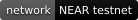
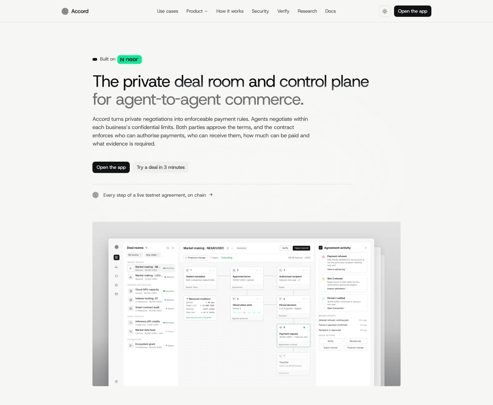
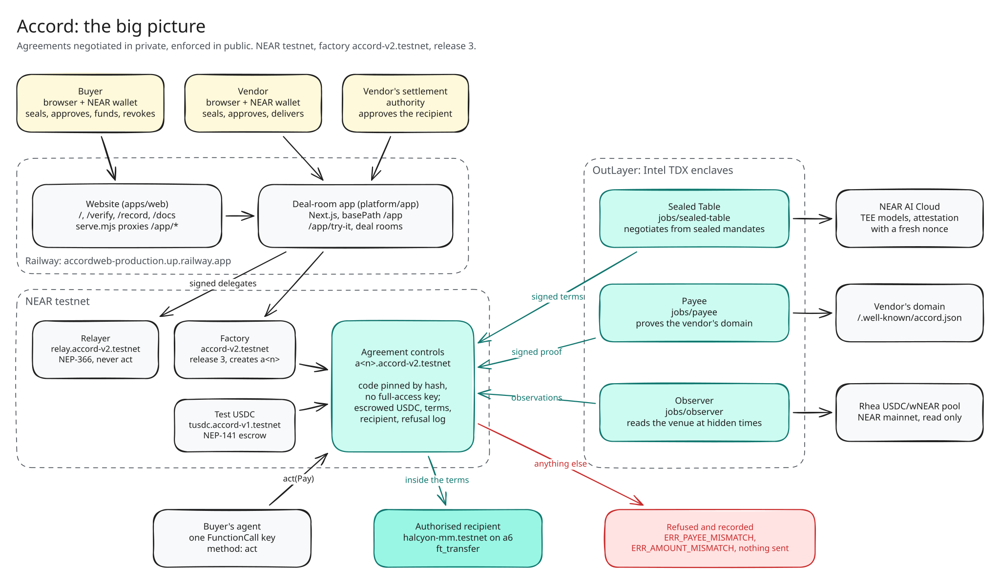
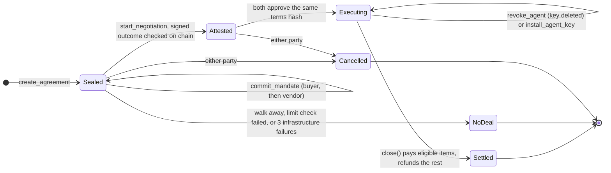
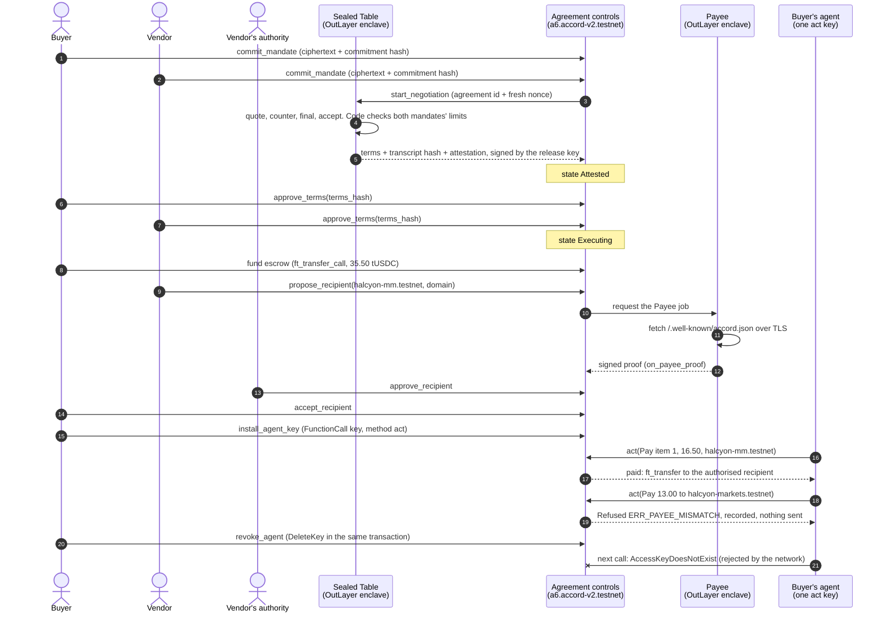
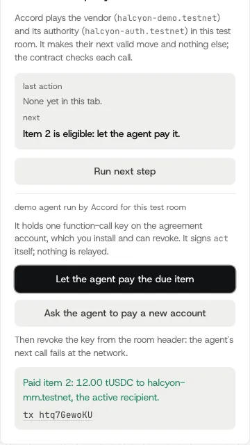
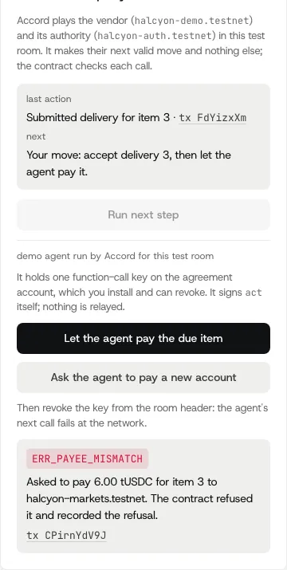

<div align="center">


# Accord

**The private deal room and control plane for agent-to-agent commerce.**

Agreements negotiated in private, enforced in public.

[Site](https://accordweb-production.up.railway.app) ·
[Run your own deal](https://accordweb-production.up.railway.app/app/try-it) ·
[Live attack room](https://accordweb-production.up.railway.app/app/try) ·
[Watch the replay](https://accordweb-production.up.railway.app/app/replay) ·
[Verify](https://accordweb-production.up.railway.app/verify) ·
[Record](https://accordweb-production.up.railway.app/record) ·
[Docs](https://accordweb-production.up.railway.app/docs)

<a href="https://testnet.nearblocks.io/address/accord-v2.testnet"></a>


<a href="LICENSE"></a>

</div>

Two companies' agents negotiate inside an attested enclave from sealed mandates. Both companies approve the terms. From then on, a NEAR contract holds the USDC and refuses any payment the buyer's agent asks for that differs from the approved item, evidence, amount or recipient. Everything runs on NEAR testnet; mainnet follows an external audit.

## Judge it in 5 minutes

1. **Run your own deal.** Open [/app/try-it](https://accordweb-production.up.railway.app/app/try-it) and choose "Try without a wallet". It runs one deal on testnet, including a refused redirect ([walkthrough](#run-your-own-deal-step-by-step)).
2. **Verify it.** Open [/verify](https://accordweb-production.up.railway.app/verify) and enter the agreement id it gives you.
   No funds, no wallet, or the faucet refuses your network: **[Watch the replay](https://accordweb-production.up.railway.app/app/replay)** of a recorded run (`a32.accord-v2.testnet`, about 60 seconds, every step with its transaction), or write to the agent in the **[Live attack room](https://accordweb-production.up.railway.app/app/try)** (pre-funded, on chain; the contract refuses what you ask it to pay).
3. **Check it from a clone**, no account and no keys: `cd platform && corepack enable && pnpm install && make verify DEAL=a10.accord-v2.testnet`.

The site is also served at [useaccord.tech](https://useaccord.tech) (the same Railway service; `www.useaccord.tech` has no certificate yet). The `/app/try-it` rooms propose their demo recipient on `useaccord.tech`, which serves the same `/.well-known/accord.json` as the Railway host.

<p align="center">
  <a href="https://accordweb-production.up.railway.app"></a>
</p>

## What is and is not verifiable today

`make verify` runs seven checks on any agreement from public data. With [`outlayer-verify`](https://github.com/out-layer/outlayer-verify) installed, it prints `verify: 6 checks ok · 1 partial` on every recorded agreement (re-run on 10 Nov 2026 on `a6`, `a10`, `a21`, `a48`, the market-making agreements `a56` and `a57`, and `a1`, `a2` of `accord-usdc.testnet`); without the tool, `release` is `not checked` and the line reads `verify: 5 checks ok · 1 partial · 1 not checked`. The privacy pillar rests partly on `model`, which is not fully checked, and on the limits below, so read them before any claim:

| Check | Today | What it means |
| --- | --- | --- |
| `code`, `keys` | ok | The agreement's code hash is a published release and the account has no full-access key |
| `sealed` | ok | The terms were signed by the Sealed Table release's key and match both on-chain commitments |
| `payee`, `record` | ok | The recipient was proven, approved and accepted; every payment matches a receipt |
| `model` | **partial** | NEAR AI's attestation report is fetched with a fresh nonce and the nonce is bound in it, but it attests the model as served now, not the negotiating run (that run's attestation is bound in the signed outcome). The hardware quote and GPU evidence are not checked by `make verify`; `make probe-ai` checks them with a NEAR AI key |
| `release` | ok, with `outlayer-verify` installed | Each job key's pubkey run (Sealed Table, Payee, observer) is looked up by OutLayer request id, its task, wasm and caller are checked against the release, and [`outlayer-verify`](https://github.com/out-layer/outlayer-verify) (commit `90c27d9d`) proves that task's TDX quote, approved measurement and binding. It proves the keys came from the release's wasm in an enclave: release 5 agreements name the reviewed job builds (Sealed Table `64a354a0…`, Payee `b5a0c473…`, observer `0dcc55e8…`), release 3 and 4 agreements release 3's (`7c832ce9…`, `24071443…`, `8240179a…`). Without the tool the check is `not checked`. The app's `/api/verify` and `/app/mcp` run the same step where their image carries the tool |

Not in place yet, and stated with the claims: on testnet the Sealed Table's seed admits any caller during an agreement's open request window (restricting it to the agreement's own calls, S1, needs a setting only OutLayer's dashboard can make); the reviewed enclave job builds run release 5 (10 Nov 2026), but the seeds still also admit release 3's job builds, which lack the factory-only check, so that release 3 and 4 rooms keep working; end-to-end encryption to the model is not shipped. Market-making agreements ran end to end on testnet on 10 Nov 2026 (`a56`, `a57.accord-v2.testnet`, test USDC, observing Rhea's pool on NEAR mainnet), for period 1 of each agreement only; the observer measures the venue's liquidity, not the market maker's own orders. Every claim with its limit: [Claims and their limits](#claims-and-their-limits), from [`platform/GOAL.md`](platform/GOAL.md).

## Testnet proof

Agreement [`a6.accord-v2.testnet`](https://testnet.nearblocks.io/address/a6.accord-v2.testnet) ran the full flow on 8 Nov 2026, on release 3 of factory `accord-v2.testnet`. The Sealed Table negotiation used the real NEAR AI model (`z-ai/glm-5.3-flash`) inside OutLayer's attested enclave: `QUOTE → COUNTER → FINAL → ACCEPT`, `35.50` tUSDC in 3 items. Settlement is a test USDC token (`tusdc.accord-v1.testnet`).

| # | Step | Transaction |
| --- | --- | --- |
| 01 | Buyer seals its limits | [`Ek9Zr1wj…`](https://testnet.nearblocks.io/txns/Ek9Zr1wjD6nrWaKHFak8UDv5Jwbaacqrdh1huNp6qwAk) |
| 02 | Vendor seals its limits | [`2Zq8pfNo…`](https://testnet.nearblocks.io/txns/2Zq8pfNoa1dFzMLAy79aGyek72q3LGcrvRqAjYABisKZ) |
| 03 | Negotiated in the enclave: `35.50 tUSDC · 3 items` | [`GfX5qKq3…`](https://testnet.nearblocks.io/txns/GfX5qKq35rvtUVkp9nBPgw3kkzDSXx6hfY2H5cb3wfHW) |
| 04 | Buyer approves the terms | [`H6cMyE6k…`](https://testnet.nearblocks.io/txns/H6cMyE6kzs9SdrC4yaP7CvnDxJqH4NSx7ivKeu2rBHSg) |
| 05 | Vendor approves the terms (state `Executing`) | [`2uv8tTfe…`](https://testnet.nearblocks.io/txns/2uv8tTfeYhe2aZ5cMrVNfFzr88kPL4HeSxwYzNhtmveT) |
| 06 | Buyer funds the escrow: `35.50 tUSDC` | [`2CeFB18j…`](https://testnet.nearblocks.io/txns/2CeFB18jenw2iggWE8mQZy9DehwZ2f97TYXwi3RVeXPy) |
| 07 | Recipient proven in the enclave (Payee) | [`6koRbw5Q…`](https://testnet.nearblocks.io/txns/6koRbw5QDYTgVU52Fe1vH755QGLPwZabQhF1kTk5rup6) |
| 08 | Vendor's authority approves | [`FBQnqtKX…`](https://testnet.nearblocks.io/txns/FBQnqtKXs5B5zn1A4F1yCDUmACYMqsi2zM2uez6YxDis) |
| 09 | Buyer accepts `halcyon-mm.testnet` | [`3d3LSZvz…`](https://testnet.nearblocks.io/txns/3d3LSZvz3yPX5LM1Bk6t9bxiX2x1JDMEt9mfa2fbw11p) |
| | Agent key installed | [`EUJ86tSV…`](https://testnet.nearblocks.io/txns/EUJ86tSVNuYsgtMVYYZZ9CYbsJmY6jCKm1Uew5doPU1C) |
| 10 | Agent pays inside the terms: `16.50 tUSDC` to `halcyon-mm.testnet` | [`2k57zg7i…`](https://testnet.nearblocks.io/txns/2k57zg7iE44muCGRbcc2JTVmy5uGHHyCePXNPmcWCKEQ) |
| 11 | Redirect to `halcyon-markets.testnet` refused: `ERR_PAYEE_MISMATCH`, nothing sent | [`AB9HLnWv…`](https://testnet.nearblocks.io/txns/AB9HLnWvkzNL418ygx8AVArinPnAK3jqxt4haAjsk8fs) |
| 12 | Buyer revokes the agent; its next call fails with `AccessKeyDoesNotExist` | [`4ervNQdj…`](https://testnet.nearblocks.io/txns/4ervNQdjrd7MA1n7vWSY7cRUtCpwiQwSK7xDSK2Bmn9P) |

**Release 5, end to end in one command, in `1:29`.** On 10 Nov 2026 (UTC) `make demo` ran the whole loop on testnet from fresh accounts against the hosted app: agreement [`a65.accord-v2.testnet`](https://testnet.nearblocks.io/address/a65.accord-v2.testnet), release 5 (the security-review fixes and the reviewed enclave job builds), test USDC. The two companies sign side by side, and the Payee job proves the recipient while the Sealed Table negotiates:

```
  00:09  accounts   demo-mwb5hpl7-buyer.northwind-demo.testnet · …-vendor · …-auth · …-pay
  00:16  created    a65.accord-v2.testnet · demo timings
  00:20  sealed     both mandates committed
  00:54  recipient  proven on the demo domain · approved · accepted · active
  00:59  attested   33.00 USDC · 3 items
  01:10  executing  approved by both · funded 33.00 USDC
  01:19  delivery   item 1 submitted · accepted
  01:24  paid       item 1 · 15.00 USDC → demo-mwb5hpl7-pay.northwind-demo.testnet
  01:29  refused    ERR_PAYEE_MISMATCH (one attack)
demo: full loop in 1:29
```

(`USDC` in this output is the test token `tusdc.accord-v1.testnet`.) `make verify DEAL=a65.accord-v2.testnet` prints `code hash ECgsrZwy… = release 5`, `keys 1 key · FunctionCall · receiver self · methods [act] · no full access · ok`, the reviewed job builds `outlayer-verify proven`, and `verify: 6 checks ok · 1 partial`. The time follows the enclave negotiation (`39 s` here); earlier runs the same night took `2:23` (a63, steps one after another) and `2:20` (a64, a `64 s` negotiation), and both verify the same way.

### Verify it yourself

No account and no keys. In the browser: [/verify](https://accordweb-production.up.railway.app/verify) shows the seven-check verdict and five quick reads live from testnet; [/record](https://accordweb-production.up.railway.app/record) shows a6's 12 steps. In a terminal:

```bash
git clone https://github.com/Adityaakr/accord.git && cd accord/platform
corepack enable && pnpm install
make verify DEAL=a6.accord-v2.testnet
```

Output, from a run on 10 Nov 2026 with [`outlayer-verify`](https://github.com/out-layer/outlayer-verify) installed (`cargo install --locked --git https://github.com/out-layer/outlayer-verify --rev 90c27d9d outlayer-verify`). The nonce is fresh on every run; `keys` reads `0 keys` because a6's agent was revoked; `release` looks each job key's pubkey run up by OutLayer request id, checks its task, wasm and caller, then `outlayer-verify` proves that task's quote. Without the tool, each run reads `and caller match · quote not checked (needs outlayer-verify)`, `release` is `not checked` and the last line is `verify: 5 checks ok · 1 partial · 1 not checked`. `/app/api/verify/<agreement>` and the MCP tool `accord_verify` print the same `release` line, `ok` where the server has the tool:

```
accord verify · a6.accord-v2.testnet
  code      code hash 8wMuMRre… = release 3 (global by hash) · no deploy method · ok
  keys      0 keys · none · no full access · ok
  sealed    outcome signature ok · commitments match · agreement matches · ok
  release   sealed-table run 13682 = task 28492 · wasm 7c832ce9… · outlayer-verify proven · payee run 13672 = task 28478 · wasm 24071443… · outlayer-verify proven · observer run 13683 = task 28493 · wasm 8240179a… · outlayer-verify proven · ok
  model     z-ai/glm-5.3-flash · attestation report fetched with fresh nonce 1a7f6315… · nonce bound in the report · the model is attested as served now; the run's own attestation is bound in the signed outcome (sealed check) · hardware quote and GPU evidence not checked here (make probe-ai checks them) · partial
  payee     halcyon-mm.testnet · proof accordweb-production.up.railway.app signed by the release's payee key · authority approved · buyer accepted · active · ok
  record    1 payment · 1 refusal (1 in the log) · 0 exceptions · 0 set aside · 0 observation conflicts · receipts match paid · ok
verify: 6 checks ok · 1 partial
```

`make verify DEAL=a10.accord-v2.testnet` prints `code hash ECgsrZwy… = release 4`, `release   sealed-table run 13987 = task 28880 · wasm 7c832ce9… · outlayer-verify proven · payee run 13988 = task 28881 · wasm 24071443… · outlayer-verify proven · observer run 13989 = task 28882 · wasm 8240179a… · outlayer-verify proven · ok` and the same last line; `make verify-usdc DEAL=a1.accord-usdc.testnet` checks the Circle USDC deal. A release 5 agreement, `make verify DEAL=a52.accord-v2.testnet`, prints `code hash ECgsrZwy… = release 5` and `release   sealed-table run 15085 = task 30189 · wasm 64a354a0… · outlayer-verify proven · payee run 15086 = task 30191 · wasm b5a0c473… · outlayer-verify proven · observer run 15082 = task 30185 · wasm 0dcc55e8… · outlayer-verify proven · ok` (it is only negotiated, so `payee` is `not checked`: `verify: 5 checks ok · 1 partial · 1 not checked`). Without `outlayer-verify`, a52's last line is `verify: 4 checks ok · 1 partial · 2 not checked`. Releases 4 and 5 run the same agreement code (`ECgsrZwy…`) and differ in the enclave job builds and keys; `verify` reads the release number from the factory's record for the agreement, then checks the code hash and all three job keys against that release.

### More runs

| Agreement | What it shows |
| --- | --- |
| `a10`, `a11`, `a13.accord-v2.testnet` | Release 4 (the security-review fixes): negotiate, fund, pay, refused redirect; an attack refused three ways (`ERR_PAYEE_MISMATCH`, `ERR_AMOUNT_MISMATCH`, `ERR_CANARY`, `0.00` moved); revoke, then a new key pays |
| `a52.accord-v2.testnet`, `a3.accord-usdc.testnet` | Release 5 (10 Nov 2026): negotiated by the reviewed Sealed Table build `64a354a0…` (`33.00 tUSDC` and `14.00 USDC`, 3 items each, attestation ok, `ERR_SEALED` both ways) |
| `a1.accord-usdc.testnet` | A deal in Circle's testnet USDC: `14.00 USDC` funded, `5.00` paid, redirect refused, revoked |
| `a8`, `a15`, `a21.accord-v2.testnet` | `/app/try-it` with a fresh account, on the public URL with relayed wallet calls, and without a wallet |
| `a32.accord-v2.testnet` | The run [Watch the replay](https://accordweb-production.up.railway.app/app/replay) plays back |
| `a56`, `a57.accord-v2.testnet` | Market making on testnet, release 5 (10 Nov 2026): `a56` period 1 observed `6 of 6` on Rhea's USDC/wNEAR pool on NEAR mainnet (spread `176 bps`, depth `36.56 / 55.00 USDC` within `300 bps`), closed `Eligible`, agent paid `6.00 tUSDC` ([`42HuyHX2…`](https://testnet.nearblocks.io/txns/42HuyHX2SPWNbnT7tKKni6WwyKKCK556vmKo3TydVPeD)); `a57`'s stricter period `0 of 6`, `Withheld`, the agent's payment refused `ERR_PERIOD_WITHHELD` ([`4W1Ud2GV…`](https://testnet.nearblocks.io/txns/4W1Ud2GVRPZnJL4uJdyEjAfdB5igT3S1DGTJxxLNcS1Y)). Both verify `6 checks ok · 1 partial` ([every step](docs/runs.md#market-making-on-testnet)) |

**Flow proofs.** A dispute, a re-delivery, a payment refused while an item is disputed, and an early close that refunds the unspent escrow ran on testnet in `a48.accord-v2.testnet` (10 Nov 2026), each step linked in [`docs/runs.md`](docs/runs.md#flow-proofs). The same flow settled in Circle's testnet USDC in `a2.accord-usdc.testnet`. Reproduce with `cd platform && make dispute-close` (Circle USDC: `make dispute-close-usdc`).

Every transaction of these runs is linked in [`docs/runs.md`](docs/runs.md); the notes behind them are in [`platform/DECISIONS.md`](platform/DECISIONS.md) sections 21 and 24 to 28.

| Infrastructure | Account or link |
| --- | --- |
| Factory | [`accord-v2.testnet`](https://testnet.nearblocks.io/address/accord-v2.testnet), release `5` current ([publish tx](https://testnet.nearblocks.io/txns/dFiMTwcYygycxQFSMpYqFfRaMaBU9uMrKtzpJQzRsmG), [made current](https://testnet.nearblocks.io/txns/8jSfWk6a3qzZRMrzqJj731njUGtRCYmWPLqLAqc3RAgF)); release `4` ([publish tx](https://testnet.nearblocks.io/txns/EB2Lz3WF1Pqt4o9y9NzUF5uc9qEhimPAPLKdwJFwvqnU)) for a10; release `3` ([publish tx](https://testnet.nearblocks.io/txns/7m8pj7u2D5aAXJ3RPbPWkhShKpJxwWHhPSpRrKr9nPVh)) for a6 |
| Circle USDC factory | [`accord-usdc.testnet`](https://testnet.nearblocks.io/address/accord-usdc.testnet), release `5` current ([publish tx](https://testnet.nearblocks.io/txns/9QVU3RU1u2TcAgmS6TV8hxxjF6hCF5UB1wtF817kGcwC), [made current](https://testnet.nearblocks.io/txns/3wK4mZVZtF8x6XNwSGbzDSyLR2nPwDqkjktsmpaoKAwi)); release `4` ([publish tx](https://testnet.nearblocks.io/txns/GovfwhMAtB28ayEndYmtiZHEo8sq9YhKVCXj8m3WFaai)); token `3e2210e1…afcb8af` (Circle USDC, 6 decimals) |
| Test USDC | [`tusdc.accord-v1.testnet`](https://testnet.nearblocks.io/address/tusdc.accord-v1.testnet) (NEP-141, 6 decimals) |
| Relayer | `relay.accord-v2.testnet` ([a relayed tx](https://testnet.nearblocks.io/txns/DyFrt2v9sGhxnRiWVwSydXPWS48exUis56YydCMmrBhC)) |
| OutLayer jobs | Sealed Table, Payee and observer, as OutLayer projects `accord-v1.testnet/accord-{sealed-table,payee,observer}`; release 3 pubkey runs `13682`, `13672`, `13683` |
| OutLayer attestation of a Sealed Table run (request `13596`, task `28391`) | [testnet-api.outlayer.ai/attestations/by-request/13596](https://testnet-api.outlayer.ai/attestations/by-request/13596) |
| Demo accounts | vendor `halcyon-demo.testnet`, authority `halcyon-auth.testnet`, recipient `halcyon-mm.testnet` |
| Demo vendor's domain | `useaccord.tech` for `/app/try-it` rooms (from 9 Nov 2026; `accordweb-production.up.railway.app` before); `make demo` (a63 to a65) and the `/try` room prove on `accordweb-production.up.railway.app`, where the app lists the fresh demo vendors; both are Accord's own site, serving the Payee file ([`/.well-known/accord.json`](https://accordweb-production.up.railway.app/.well-known/accord.json)) for Halcyon, a fictional company. A real vendor serves the same file on its own domain |

## Use from an agent

Everything below reads NEAR testnet with no account and no keys. Run it from `platform/` after `corepack enable && pnpm install`.

**Check a payment before signing.** [`/app/check`](https://accordweb-production.up.railway.app/app/check), or as JSON on the live attack room, which is executing: `GET https://accordweb-production.up.railway.app/app/api/check?agreement=a14.accord-v2.testnet&item=1&amount=0.01&recipient=halcyon-mm.testnet` answers `"verdict": "pay"` ("Would be paid: 0.01 tUSDC to halcyon-mm.testnet for item 1."), and the same call with `recipient=halcyon-markets.testnet` answers `"verdict": "refuse"`, `ERR_PAYEE_MISMATCH` (both on 10 Nov 2026; the room's state moves as visitors use it). It answers whether the agreement's contract would pay or refuse that payment, gate by gate (CORS any origin, GET only, 30 a minute per IP). It is a read-only simulation of `accord-core`'s `check_pay`, the function `act` calls, over chain state at one block: no transaction, and the contract decides at the time of the real call. Replayed against 24 recorded payments and refusals, it matches every one.

**Price funding from another chain.** `pnpm --silent --filter @accord/cli dev -- fund-quote --agreement a6.accord-v2.testnet`, or `GET https://accordweb-production.up.railway.app/app/api/fund-quote/a6.accord-v2.testnet` (CORS any origin, cached 60 s). NEAR Intents' 1Click prices delivering the agreement's total as native USDC on NEAR from USDC on Base, Ethereum, Arbitrum and Solana. Every request is `dry: true`: 1Click signs the quote and returns no deposit address, so nothing is signed or sent. A run on 10 Nov 2026:

```
accord fund-quote · a6.accord-v2.testnet · total 35.50 tUSDC · NEAR Intents 1Click, dry quote: nothing is signed or sent
  base      send 35.865347 USDC on Base → 35.50 USDC on NEAR · about 35 s
  eth       send 35.86546 USDC on Ethereum → 35.50 USDC on NEAR · about 45 s
  arb       send 35.865438 USDC on Arbitrum → 35.50 USDC on NEAR · about 25 s
  sol       send 35.865438 USDC on Solana → 35.50 USDC on NEAR · about 20 s
  signed    by 1Click ed25519:5vbW1wjAKv… at 2026-11-10T20:35:46.054Z
  scope     1Click runs on NEAR mainnet only: this prices the same total on mainnet; a testnet agreement cannot receive it
```

**MCP server** (`@accord/mcp`, stdio by default). With no key in the environment it serves 7 read-only tools: `accord_list_agreements`, `accord_get_agreement`, `accord_due_items`, `accord_preflight`, `accord_refusals`, `accord_receipts` and `accord_verify`. The paying and principal tools appear only when their keys are set ([`platform/INTERFACES.md`](platform/INTERFACES.md) section 12).

```bash
ACCORD_FACTORY=accord-v2.testnet pnpm --silent --filter @accord/mcp dev            # stdio
ACCORD_FACTORY=accord-v2.testnet pnpm --silent --filter @accord/mcp dev -- --http 3333   # streamable HTTP at http://127.0.0.1:3333/mcp
```

On start it prints `accord-mcp · 7 tools · agent off · principal off` on stderr. An MCP client config runs the first command with `cwd` set to `platform/`.

**Without cloning.** A hosted, keyless, read-only MCP server at `https://accordweb-production.up.railway.app/app/mcp` (streamable HTTP; the 7 read tools; any origin; 60 requests a minute per IP). The site describes it at [`/.well-known/mcp.json`](https://accordweb-production.up.railway.app/.well-known/mcp.json):

```json
{ "mcpServers": { "accord": { "type": "http", "url": "https://accordweb-production.up.railway.app/app/mcp" } } }
```

Local stdio, from a clone (`cd platform && corepack enable && pnpm install` builds it):

```json
{ "mcpServers": { "accord": { "command": "node", "args": ["/path/to/repo/platform/packages/mcp/dist/main.js"] } } }
```

With the same deploy, the verify API and the public record CSV can be read from any origin (CORS `*`, GET only): `curl -H 'Origin: https://example.com' https://accordweb-production.up.railway.app/app/api/verify/a10.accord-v2.testnet`; the CSV is at `/app/record.csv`. Amounts are in the agreement token's own unit: tUSDC is the test token (`tusdc.accord-v1.testnet`, no value), USDC is Circle's testnet USDC (`accord-usdc.testnet` agreements). The packages are not published to npm yet.

Preflight on testnet: three of its signals, `age_days`, `tx_30d` and `code_changed_30d`, return `unavailable`. No keyless indexer gives an account's age or its transaction count, and `code_changed_30d` needs an archival RPC (`NEAR_ARCHIVAL_RPC_URL`), which is not set by default and which did not serve testnet state from 30 days back when tried on 9 Nov 2026. The rating comes from the RPC account read (exists, is a contract), the agreement (authorised recipient, canaries) and the factory's reports, blocklist and recipient stats.

**CLI** (`accord`; read-only commands need no key):

```bash
ACCORD_FACTORY=accord-v2.testnet pnpm --silent --filter @accord/cli dev -- show --agreement a6.accord-v2.testnet
ACCORD_FACTORY=accord-v2.testnet pnpm --silent --filter @accord/cli dev -- receipts --agreement a6.accord-v2.testnet --json
```

**SDK** (`@accord/sdk`, TypeScript on `near-api-js`; `pnpm install` builds it):

```ts
import { Accord, verify } from "@accord/sdk";
const accord = new Accord({ network: "testnet", factory: "accord-v2.testnet" });
const report = await verify(accord, "a6.accord-v2.testnet"); // { checks: [{ name, status, detail }], ok, partial, failed, notChecked }
```

**HTTP**: the live app returns the same seven-check report as JSON, with a nonce you choose (64 hex characters) or one it generates:

```bash
curl -s https://accordweb-production.up.railway.app/app/api/verify/a6.accord-v2.testnet
```

An account that is not an Accord agreement answers `404` with `{"error":"<account> is not an Accord agreement"}` (live: `/app/api/verify/nobody.testnet`). The site also serves [/llms.txt](https://accordweb-production.up.railway.app/llms.txt) and [/facts.json](https://accordweb-production.up.railway.app/facts.json).

## The problem

Whose server do your agents meet on? When both companies bring an agent, each needs its limits to stay private while the outcome stays binding. The money step is where it breaks today: business email compromise alone cost `$3.05 billion` across `24,768` complaints in 2025 ([FBI IC3 2025 report](https://www.ic3.gov/AnnualReport/Reports/2025_IC3Report.pdf)). Agents read their instructions from the same inbox an attacker can write to. Accord puts the negotiation in an enclave and the payment rules in a contract, so a fooled agent can ask but cannot pay outside the terms.

## Impact

The same failure costs money in web2 and web3: an agent, or a person, is told to pay somewhere else, and nothing between the instruction and the money checks it against what both companies agreed.

| | The number | Source |
| --- | --- | --- |
| Web2 · payment fraud | `76%` of US organisations had attempted or actual payments fraud in 2025; `74%` were hit by business email compromise | [AFP Payments Fraud and Control Survey, Apr 2026](https://www.financialprofessionals.org/about/learn-more/press-releases/Details/over-75-percent-of-us-firms-experienced-payments-fraud-in-2025-while-ai-adoption-for-fraud-mitigation-lags) |
| Web2 · vendor impersonation | Vendor imposter fraud cited by `45%` of organisations, up `11` points in a year | [AFP survey, Apr 2025](https://www.financialprofessionals.org/about/learn-more/press-releases/Details/survey-79-percent-of-organizations-were-victims-of-attempted-or-actual-payments-fraud-activity-in-2024) |
| Web2 · losses | Business email compromise: `$3.05 billion` across `24,768` complaints in 2025 | [FBI IC3 2025 report](https://www.ic3.gov/AnnualReport/Reports/2025_IC3Report.pdf) |
| Web2 · where agents are going | "AI agents will intermediate more than `$15 trillion` in B2B spending by 2028" (Gartner, as reported) | [Digital Commerce 360, Nov 2025](https://www.digitalcommerce360.com/2025/11/28/gartner-ai-agents-15-trillion-in-b2b-purchases-by-2028/) |
| Agents · the open risk | "it is unclear if there are fool-proof methods of prevention for prompt injection" | [OWASP LLM01:2025](https://genai.owasp.org/llmrisk/llm01-prompt-injection/) |
| Web3 · keys | Private key compromise was `43.8%` of stolen crypto in 2024; over `$3.4 billion` stolen in 2025 | [Chainalysis, Dec 2024](https://www.chainalysis.com/blog/crypto-hacking-stolen-funds-2025/), [Dec 2025](https://www.chainalysis.com/blog/crypto-hacking-stolen-funds-2026/) |
| Web3 · market makers | Binance: "Not every market-making arrangement is aligned with long-term market integrity"; in Mar 2025 it offboarded the market maker in the MOVE case | [The Block, Mar 2026](https://www.theblock.co/post/395111/binance-points-market-maker-token-launch-red-flags-updated-trading-rules), [Mar 2025](https://www.theblock.co/post/347931/binance-move-market-maker-movement-38-million-usdt-buyback-program) |
| Web3 · stablecoin B2B | B2B was half of `$6 billion` in real-world stablecoin payments in Feb 2025, up `288%` in a year (Artemis, as reported) | [Ledger Insights, Jun 2025](https://www.ledgerinsights.com/new-research-into-real-world-stablecoin-payments-shows-some-surprising-results/) |

**The gap Accord fills.** The agent payment rails launched in 2025 let one party's agent pay: [Visa Intelligent Commerce](https://usa.visa.com/about-visa/newsroom/press-releases.releaseId.21366.html), [Mastercard Agent Pay](https://newsroom.mastercard.com/news/press/2025/april/mastercard-unveils-agent-pay-pioneering-agentic-payments-technology-to-power-commerce-in-the-age-of-ai) (agentic tokens), [Google AP2](https://cloud.google.com/blog/products/ai-machine-learning/announcing-agents-to-payments-ap2-protocol) (one user's mandate for a merchant's cart), [Stripe and OpenAI's ACP](https://stripe.com/blog/developing-an-open-standard-for-agentic-commerce) and [x402](https://www.x402.org/). None of them holds terms that two companies negotiated and both approved, or binds the recipient to a proof both accepted. Accord is that layer: the negotiation stays private in an enclave, and the contract refuses any payment outside the approved item, evidence, amount and recipient, whoever was fooled.

| Who | What changes for them | Shown on testnet by |
| --- | --- | --- |
| Finance and treasury teams | A redirected or altered payment is refused by the contract and recorded; the team is told on Telegram, by webhook or in the app; exports match the record | a6 and a63 `ERR_PAYEE_MISMATCH`; the [Live attack room](https://accordweb-production.up.railway.app/app/try) |
| Procurement teams | "Walmart, like most organizations with large procurement operations, can’t possibly conduct focused negotiations with all of its 100,000-plus suppliers" ([HBR, 2022](https://hbr.org/2022/11/how-walmart-automated-supplier-negotiations)): agents negotiate each supplier inside limits neither side sees, and payment follows only the approved terms | a6: `QUOTE → COUNTER → FINAL → ACCEPT`, `35.50 tUSDC · 3 items` |
| Token projects hiring market makers | Payment only for periods an enclave observer measured as met, so a weak period is withheld on chain, not argued about | a56 paid (`Eligible`), a57 refused `ERR_PERIOD_WITHHELD` |
| Agent developers | A payment check before the call (`/app/check`), a read-only MCP server, the CLI and the SDK: an agent asks "would this pay?" and gets the contract's answer | [Use from an agent](#use-from-an-agent) |

None of the organisations named in this section uses or endorses Accord; their numbers and words describe the problem. Accord has no customers yet: it runs on NEAR testnet with test USDC and fictional companies (Northwind buying from Halcyon).

## How it works

Four parts, named the same in the app, the docs and the code:

| Part | What it does | Code |
| --- | --- | --- |
| Sealed Table | Two agents negotiate inside an OutLayer enclave from mandates sealed in each browser. Code checks every proposal against both mandates' hard limits. Only the terms, commitment hashes, a transcript hash and an attestation leave. | [`platform/jobs/sealed-table`](platform/jobs/sealed-table) |
| Agreement controls | One NEAR account per agreement, code pinned by hash, no full-access key. It holds the USDC escrow and runs `act`, the agent's only method. | [`platform/contracts/agreement`](platform/contracts/agreement) |
| Payee | The vendor proves its domain inside an enclave, its settlement authority approves the account, the buyer accepts it. A change needs all three again and a 24-hour delay in live mode; testnet agreements run in demo mode, where a change waits 120 s and a claim 120 s. | [`platform/jobs/payee`](platform/jobs/payee) |
| Evidence checks | A payment becomes eligible only when the agreed evidence is recorded: delivery accepted, or (market making) enough observations of the venue pass. | [`platform/jobs/observer`](platform/jobs/observer), [`platform/crates/accord-core`](platform/crates/accord-core) |

> The model never decides where money goes. The contract does. The worst a hijacked agent can do is make a payment you already approved, to the recipient you already accepted, when it falls due.

<p align="center">
  <a href="docs/diagrams/accord-architecture.excalidraw">.accord-v2.testnet holds escrowed test USDC, the approved terms, the recipient and the refusal log. OutLayer enclaves (Sealed Table, Payee, Observer) send signed terms, proofs and observations to the agreement; the Sealed Table calls NEAR AI Cloud, Payee reads the vendor's domain, the Observer reads Rhea on NEAR mainnet. The buyer's agent calls act(Pay); inside the terms the agreement pays the authorised recipient, anything else is refused and recorded." width="100%" /></a>
  <br/><sub>The big picture. Source: <a href="docs/diagrams/accord-architecture.excalidraw"><code>docs/diagrams/accord-architecture.excalidraw</code></a> (open it at excalidraw.com). The full design: <a href="platform/ARCHITECTURE.md"><code>platform/ARCHITECTURE.md</code></a>.</sub>
</p>

The relayer pays gas for the calls a visitor's wallet signs as NEP-366 delegates (Meteor and Intear send through it), and it carries only calls that attach at most 1 yoctoNEAR; the room's 2 NEAR deposit is signed and paid by the user's own wallet, in its own transaction. It never carries `act`: the contract identifies the agent by its signing key, and a relayer's key would replace it.

**The `act()` gates.** Authentication comes first (the signing key must be the current agent key or a recently revoked one; anything else panics with `ERR_UNAUTHORIZED` and is not recorded). Then six gates in a fixed order; the first failure is recorded and `act` returns `Refused{code}`. A refusal never panics, so it is on the record. Five refusals by the same key inside an hour revoke it automatically.

| Gate | Checks | Refusal codes |
| --- | --- | --- |
| 1. Key and state | The key is not revoked; state is `Executing` | `ERR_REVOKED`, `ERR_NOT_EXECUTING` |
| 2. Recipient | Not a canary (a canary also deletes the key); an active authorised recipient exists; the request names it | `ERR_CANARY`, `ERR_NO_RECIPIENT`, `ERR_PAYEE_MISMATCH` |
| 3. Item | The item exists and is unpaid | `ERR_UNKNOWN_ITEM`, `ERR_ALREADY_PAID` |
| 4. Evidence | Delivery accepted (or the window lapsed undisputed); for market making, the period closed `Eligible`; or an approved exception waives it | `ERR_NOT_DUE`, `ERR_PERIOD_WITHHELD` |
| 5. Amount | Equals the item amount (or its approved exception); stays within the total; the escrow covers it | `ERR_AMOUNT_MISMATCH`, `ERR_CAP_EXCEEDED`, `ERR_INSUFFICIENT_FUNDS` |
| 6. Lock | No payment in flight | `ERR_IN_FLIGHT` |

Source: [`platform/ARCHITECTURE.md`](platform/ARCHITECTURE.md) section 6.

<details>
<summary>Diagrams: the agreement lifecycle, and one deal end to end (a6)</summary>



States are the contract's own (`State` in [`platform/crates/accord-core/src/types.rs`](platform/crates/accord-core/src/types.rs)).



</details>

## Run your own deal, step by step

Open [`/app/try-it`](https://accordweb-production.up.railway.app/app/try-it) (live since 9 Nov 2026; to run it locally, see [Run locally](#run-locally); the faucet, demo counterparty and demo agent need the `FAUCET_*`, `DEMO_*` and `RELAYER_*` variables named in [`platform/.env.example`](platform/.env.example)). Everything there is NEAR testnet with test USDC. The vendor in your room is Accord's demo vendor (`halcyon-demo.testnet`, authority `halcyon-auth.testnet`) and the agent is a demo agent run by Accord for test rooms; both are labelled in the room. Amounts differ from room to room: they are what the negotiation produced.

| # | Do | See |
| --- | --- | --- |
| 1 | **Try without a wallet**, or **Connect a wallet** (a NEAR testnet wallet such as Meteor or Intear). Without a wallet, the page makes a throwaway testnet key in this tab (sessionStorage only, never sent to the server, gone when the tab closes), and steps 2 and 3 run on their own | `01` marked done, with your account; for the throwaway key, its implicit account labelled `Throwaway testnet key` |
| 2 | **Get test funds** (once a day per account, up to 30 accounts per connection a day, within a daily budget; if the faucet refuses, the step offers Watch the replay, the Live attack room and Verify) | `0.00 NEAR` becomes `2.35 NEAR · 100.00 tUSDC`, both faucet transactions linked |
| 3 | **Create the room** | `Your room is a8.accord-v2.testnet: My first deal room.` (your number will differ) |
| 4 | **Seal your mandate** with the Northwind preset (`40` tUSDC ceiling, 2 to 4 items) | In the Demo counterparty panel: `Sealed the vendor's mandate (Halcyon procurement preset)`, then `Started the negotiation in the Sealed Table`; the state moves `Sealed` to `Attested` |
| 5a | In your room, **approve the terms**, **fund** the escrow, **accept the recipient**, then **accept delivery 1** as the counterparty acts | `Approved the terms as the vendor`, `Proposed halcyon-mm.testnet as the recipient on useaccord.tech`, `Submitted delivery for item 1` |
| 5b | **Start the demo agent** (your wallet or throwaway key signs `install_agent_key`). Then wait: the agent pays the accepted item on its own, with no click, within about 2 minutes | The agent bar and the Activity tab: `Paid item 1: 16.50 tUSDC to halcyon-mm.testnet.` with the `act` transaction (`payment_sent`) |
| 5c | **Ask the agent to pay a new account** | `ERR_PAYEE_MISMATCH` and `Asked to pay … to halcyon-markets.testnet. The contract refused it and recorded the refusal.` |
| 5d | **Hold to revoke** in the room header | `Agent revoked · next call rejected by the network` |
| 6 | With a throwaway key: **Finish: close the room and return the test NEAR** (Reset does the same) | `Done. The room is closed and its test NEAR and test USDC are back with the faucet.` with the `ft_transfer` and `delete_account` transactions linked, then `Room a<n>.accord-v2.testnet · Verify it →`. The room closes by `mutual_close` with the demo vendor, `withdraw_near` returns its deposit, the test USDC goes back to the faucet, and the throwaway account deletes itself into the faucet |

The literal path is [`platform/app/e2e/try-without-wallet.mjs`](platform/app/e2e/try-without-wallet.mjs) (Playwright; it never clicks a pay button). The server side is [`platform/app/src/server/demo.ts`](platform/app/src/server/demo.ts) and [`demoagent.ts`](platform/app/src/server/demoagent.ts): the counterparty makes the vendor's next valid move, so calling it twice does nothing twice; the demo agent's key is derived per room and signs `act` itself, never through the relayer.

<p align="center">
  
  &nbsp;&nbsp;
  
  <br/><sub>The demo agent's panel: a payment inside the terms, then a redirect the contract refused.</sub>
</p>

### Settle in Circle USDC

A second factory, `accord-usdc.testnet`, runs the same code (release 5 since 10 Nov 2026) and settles in Circle's USDC on NEAR testnet, `3e2210e1184b45b64c8a434c0a7e7b23cc04ea7eb7a6c3c32520d03d4afcb8af` (6 decimals). Each agreement keeps its factory's token for life, so `a<n>.accord-usdc.testnet` takes only Circle USDC and `a<n>.accord-v2.testnet` only test USDC. `/app/try-it` defaults to test USDC; Circle USDC is offered next to it where the server sets `ACCORD_FACTORY_USDC`.

| Do | See |
| --- | --- |
| Get Circle testnet USDC at https://faucet.circle.com, network `NEAR Testnet`, your account as the address | about `20 USDC` per address every 1 to 2 hours |
| `make verify-usdc DEAL=a1.accord-usdc.testnet` (the same as `make verify DEAL=a1.accord-usdc.testnet`, which reads the factory from the id) | `code hash 8wMuMRre… = release 3 (global by hash)` · `release   sealed-table run 13909 = task 28801 · wasm 7c832ce9… · outlayer-verify proven` (and the same for payee run `13910` = task `28802` and observer run `13911` = task `28803`) · `verify: 6 checks ok · 1 partial` with `outlayer-verify` installed (without it: `5 checks ok · 1 partial · 1 not checked`) |
| `make negotiate-usdc`, then `make finish-usdc DEAL=<agreement>` once the buyer holds the terms' total | the same blocks as `make negotiate` and `make finish`, with Circle USDC; the presets fit one faucet drip (buyer ceiling `18`, vendor floor `12`) |

## What the agent's key can and cannot do

It can call one method, `act`, on one account: the agreement it works for. It cannot attach NEAR, transfer NEAR, add or delete keys, deploy code, delete the account, or call any other contract. It spends gas from a fixed allowance (`0.5 NEAR` by default). One buyer transaction, `revoke_agent`, ends it. More: [`platform/README.md`](platform/README.md#what-the-agents-key-can-and-cannot-do).

<p align="center">
  <a href="docs/diagrams/accord-attacks.excalidraw"></a>
  <br/><sub>Where each attack stops. Source: <a href="docs/diagrams/accord-attacks.excalidraw"><code>docs/diagrams/accord-attacks.excalidraw</code></a>. The threat model is <a href="platform/ARCHITECTURE.md"><code>platform/ARCHITECTURE.md</code></a> section 16.</sub>
</p>

## Claims and their limits

Verbatim from [`platform/GOAL.md`](platform/GOAL.md). Every public statement about Accord is one of these, stated with its limit. The site's [/security](https://accordweb-production.up.railway.app/security) page shows the same table.

| We claim | Because | Limit, stated next to it |
| --- | --- | --- |
| Each company's mandate is readable only inside attested enclaves | The browser encrypts the mandate to a key derived from a seed generated inside the Sealed Table's enclave, bound to its release build and readable only by runs an agreement requests or that publish the key's public half; the chain holds the ciphertext and a commitment hash; the two negotiators run on NEAR AI Cloud models in TEEs, and the gateway's and the model's attestations are verified with a fresh nonce | Under the hardware's trust assumptions (Intel TDX, NVIDIA confidential computing) and OutLayer's keystore governance. The deployer owns the seed and the factory account, and could rebind the seed to another build or request extra runs. On testnet the job's seed condition admits any caller during an agreement's open request window, so an outside party could request extra runs then and learn bounds on the limits; restricting the seed to the agreement's own calls is the next step. Prompts reach the model through NEAR AI's attested gateway over TLS (TLS binding is not checked from inside the job); end-to-end encryption to the model is not shipped yet. The browser trusts the code the app serves; the CLI is the alternative. The ciphertext stays on chain. The final terms reveal that each side accepted them, as any signed deal does. A negotiator can concede in words; code checks the numbers |
| The approved terms are the agent's only authority | The agent's only key is a function-call key on the agreement's own account that can call `act` and nothing else; `act` refuses any payment whose item, evidence, amount or recipient differs from the terms both companies approved | The agent's judgement is bounded, not protected: it can still be fooled into asking. Attestation proves which code produced the terms, not that the deal was good; people decide that when they approve |
| Payments go only to the authorised recipient | The recipient is a NEAR account listed in a file on the vendor's domain, fetched inside an enclave; the vendor's settlement authority approves it on chain and the buyer accepts it; a change needs all three again and a 24-hour delay | Authorisation proves control of the domain and the authority's approval, not that the company legally exists. A legal KYB check is a later integration. Testnet agreements run in demo mode: a recipient change waits 120 s and a claim 120 s; live mode enforces at least 24 h for a recipient change and 72 h for a claim, checked by the factory and again by the agreement |
| Revoking ends the agent's authority in one transaction | `revoke_agent` marks the agent's key revoked, so the contract refuses it from that receipt on, and deletes it from the agreement account in the same transaction; the account has no other key, so after the deletion lands (about one block) anything the agent signs is rejected by the network before it reaches the contract | A payment already made stays made, and it went to the authorised recipient at the approved amount. A call that reached the chain before the revoke still runs, with every check. Revoking never cancels what the vendor has earned: an eligible payment stays claimable by the vendor |
| Negotiation is private; settlement is public | Mandates and the transcript stay inside enclaves; only the terms, commitment hashes, a transcript hash and attestation references leave; the commercial terms document is encrypted to the two parties | The enforced schedule (amounts, dates, recipient) and every payment are public on NEAR, as with any stablecoin payment |
| A market-making agreement's payment becomes eligible only when the agreed observations pass, unless the buyer approves an exception | Each slot's time is drawn inside the observer's enclave from a seed generated there; the observation is taken at the first NEAR mainnet block after that time, signed by the observer's key, and checked by the contract against the agreed spread, depth and two-sided quoting; anyone can recompute it from an archival node | A market-making agreement's observer measures the venue's liquidity, not the market maker's own orders. The deployer owns the observer's seed and could rebind it to a build that reveals slot times in advance. A slot nobody polls in time counts as unobserved, and a period that unobserved slots leave undecided, or that has conflicting observations, goes to the buyer, not to payment |

Custody per piece and the privacy boundary: [`platform/README.md`](platform/README.md#custody-per-piece).

### What we keep

The app's server never sees a mandate and no route accepts one ([`platform/app/tests/no-mandate-routes.test.ts`](platform/app/tests/no-mandate-routes.test.ts) fails if one does). It stores only the `/try` inbox (with a salted daily hash of the visitor, never the IP address), the buyer's signed approvals of warned recipients, demo-domain registrations, the `/try` rooms, the faucet's per-account grants and daily balance, and service heartbeats; see [`platform/app/src/server/README.md`](platform/app/src/server/README.md). The Sealed Table holds a mandate's plaintext only in memory during its run.

## Security review

An internal security review, not a third-party audit: five AI-assisted review passes, each on a separate code area (the payment path; authorisation and keys; creation and code integrity; funds; the enclave jobs), with every finding re-checked by separate AI review passes that reproduced it as a test, found 1 High and 5 Medium issues (one of them Medium-Low), plus 4 groups of Low findings (13 individual items). The High one was a close-refund drain: a deposit sent during `close` could make the refund to the buyer spend the vendor's reserve; the refund is now capped at the ledger while anything is owed to the vendor. Severities are self-assigned. Each fix landed with a failing test that it makes pass. The contract and factory fixes are live as release 4 on both testnet factories ([proofs](docs/runs.md#release-4-security-review-fixes)); agreements created before (a6, a8 and a1.accord-usdc.testnet) keep release 3's code by hash, so they keep the close-refund issue.

Scope: the contracts, the factory and the enclave jobs. The app server, the relayer and the demo endpoints were outside it; the relayer deposit issue (`platform/DECISIONS.md` 27) was found later by a live run and fixed the same day. Changed limit: an item left `AssumedPaid` (its transfer sent, its callback not yet answered) is no longer refunded to the buyer at `Settled`; its amount stays on the agreement's account until that payment's callback answers. Limit: S1 is partial (see [What is and is not verifiable today](#what-is-and-is-not-verifiable-today)). Every finding, fix, test and commit: [`platform/DECISIONS.md`](platform/DECISIONS.md) section 25. Mainnet follows an external audit, which has not happened yet.

CI (`.github/workflows/ci.yml`) runs the contract and factory tests, the review tests among them (`cargo test -p accord-core -p accord-agreement -p accord-factory`), `pnpm -r typecheck` and every package, service and app test, and the website's `npm run check`, `test:serve` and build; the sandbox tests on a local node (`make sandbox`, including `tests/tests/audit.rs`) and the enclave job tests (`jobs/*/tests`) run locally only.

## Track by track

The organisers' requirements per track ([`platform/GOAL.md`](platform/GOAL.md) "Track requirements"), and where each is shown.

| Track | Requirement | Shown by |
| --- | --- | --- |
| `security` | The agent signs with a function-call key scoped to one contract, never a full-access key | [What the agent's key can and cannot do](#what-the-agents-key-can-and-cannot-do); `make verify` `keys` line |
| `security` | A prompt-injected agent tries to pay a bad address and is stopped, with the log | The [Live attack room](https://accordweb-production.up.railway.app/app/try); `make attack`; a11's three refusals in [`docs/runs.md`](docs/runs.md#release-4-security-review-fixes) |
| `security` | A wrapper that blocks or asks a human, with data sources per signal | `preflight()` in the SDK and `accord_preflight` return `allow`, `warn` or `block`; `warn` waits for the buyer in the app; signals and sources in [`platform/ARCHITECTURE.md`](platform/ARCHITECTURE.md) section 7.3. Three signals are `unavailable` on testnet ([above](#use-from-an-agent)) |
| `privacy` | NEAR AI Cloud, a TEE model, attestation with a fresh nonce, a Verified panel | `z-ai/glm-5.3-flash` in the Sealed Table; the room's Verified panel and `/verify`; `make probe-ai`. The model check is `partial` in `make verify` ([why](#what-is-and-is-not-verifiable-today)) |
| `privacy` | Keep nothing server-side; fictional sample documents | [What we keep](#what-we-keep); [`platform/fixtures/companies`](platform/fixtures/companies) (Northwind, Halcyon) |
| `agents` | Negotiate: counter once with reasons, then accept or walk away | a6: `QUOTE → COUNTER → FINAL → ACCEPT`; `make negotiate` |
| `agents` | Payments in USDC; a receipt per task | tUSDC and Circle USDC on NEAR; `/record`, `/app/record.csv`, `accord receipts` |
| `agents` | Agent Market: how jobs are posted and paid, or say there is no public way | Checked 31 Oct 2026: Agent Market is mainnet-only and holds payments in its own ledger, with no hook for an outside escrow, so Accord does not integrate it (`platform/DECISIONS.md` section 7) |
| `business` | Humans set the constraints; a kill switch | Mandates, both approvals, exceptions; `revoke_agent` (`make revoke`, a13) |
| `business` | Every sale and payout on a public ledger; a demo loop under two minutes | `/record`; `make demo` ran the loop on testnet in `1:29` from fresh accounts (a65, 10 Nov 2026 UTC: the two companies sign side by side and the Payee proof runs during the negotiation); the time moves with the enclave negotiation, which took `39 s` there and `64 s` in a slower run (a64, `2:20`). On a local node it runs in 14 s |

Not claimed: `realworld`, `social` and `swarms`. Their extra requirements (an invoice view paid through 1Click, a Sputnik DAO as the buyer, a sealed tender) are not built.

## Related NEAR tools

| Tool | How Accord relates |
| --- | --- |
| NEAR AI Cloud | Used: private inference for both negotiators, with attestations fetched with a fresh nonce |
| OutLayer | Used: Intel TDX enclaves for the Sealed Table, Payee and the observer; outputs signed with seed-derived keys and checked on chain |
| HOT Connect | Used: wallet sign-in in the app (Meteor, Intear, Ledger, Nightly, WalletConnect) |
| NEAR Intents Agent API | Not used. It gives one owner a policy-bound wallet for an agent (limits, allowlist, timelocks, approval, freeze). Accord is the policy two companies negotiated and both approved, enforced on an account neither can drain alone, with payments gated by evidence. The two could meet: an agreement's recipient and caps could be exported into such a policy (not built) |
| NEAR Intents 1Click | Used, quote only: what funding an agreement's total from USDC on Base, Ethereum, Arbitrum or Solana would cost, as `dry: true` quotes (nothing signed or sent). `accord fund-quote --agreement a6.accord-v2.testnet`, `GET /app/api/fund-quote/<agreement>` and the room's "Fund from another chain" panel. 1Click has no testnet, so for a testnet agreement it is a mainnet price |
| Agent Market | Not integrated: mainnet-only, with payments held in its own ledger and no outside escrow hook |
| Sputnik DAO, Trezu | Not integrated. A DAO as the buyer (proposals to create, fund and approve) was designed and not built; Trezu is mainnet-only |
| Chain Signatures | Not used: settlement is USDC on NEAR from the agreement's own account |

## Business model (hypothesis)

Free on testnet with test funds. Planned, still a hypothesis: buyers pay per agreement, and vendors pay per recipient authorisation. Building on Accord and verifying an agreement stay free. Never a percentage of payments. Production prices are published before launch.

## Sustainability

### The loop that pays for itself

1. A buyer opens an agreement and pays for it (planned per-agreement fee, [above](#business-model-hypothesis)).
2. Each vendor it buys from joins free, because joining is how it gets paid; its proven domain and recipient are reusable in every later agreement, with any buyer.
3. Vendors that buy from their own suppliers open agreements too, and bring their vendors in free. Each paying buyer adds unpaid vendors who are one step from paying.
4. Verifying stays free for anyone (`make verify`, the MCP server, `/app/api/verify`), so tools built on top send more agreements, not less trust.

Revenue grows with the number of agreements, never with a cut of the money moving through them, and the costs it pays are per agreement too: a `2 NEAR` creation deposit on testnet (global code, by hash), the enclave runs and the model calls.

### Partners whose products fit

Candidates, not partners: no relationship with any of them is claimed.

| Candidate | Their product | The fit |
| --- | --- | --- |
| [Circle](https://www.circle.com/multi-chain-usdc/near) | Native USDC on NEAR | `accord-usdc.testnet` already settles in Circle's testnet USDC; mainnet settles in native USDC |
| [Pactum](https://pactum.com/) | AI supplier negotiation agents | The terms its agents reach could be the terms an Accord agreement enforces at payment time |
| [Coupa](https://siliconangle.com/?p=754391) | Procurement suite with AI agents (and Pactum for negotiation) | Where the pre-payment check, refusal alerts and finance exports meet the buyer's existing approvals |
| [Stripe and OpenAI ACP](https://stripe.com/blog/developing-an-open-standard-for-agentic-commerce), [Google AP2](https://ap2-protocol.org/), [Visa Intelligent Commerce](https://usa.visa.com/about-visa/newsroom/press-releases.releaseId.21366.html), [Mastercard Agent Pay](https://newsroom.mastercard.com/news/press/2025/april/mastercard-unveils-agent-pay-pioneering-agentic-payments-technology-to-power-commerce-in-the-age-of-ai) | Agent checkout and card rails for one party's agent | Accord adds the two-company terms and the recipient both approved; an agent's token or mandate could be scoped to an approved agreement |
| [x402](https://www.x402.org/) | HTTP-native stablecoin payments, with NEAR among its launch collaborators | An x402 payment could be gated by the agreement's recipient and amount checks |
| [Rhea Finance](https://www.rhea.finance/) | NEAR DEX | The market-making observer already measures a Rhea pool (a56, a57) |
| Exchanges that police market-maker deals ([Binance](https://www.binance.com/en/blog/community/483141898861583811)) | Due diligence on token projects' market makers | A market-making agreement's on-chain record of measured periods is evidence a project can show a listing team |
| [NEAR Intents / 1Click](https://docs.near-intents.org/), [OutLayer](https://app.outlayer.ai/), [NEAR AI Cloud](https://docs.near.ai/cloud/private-inference) | Cross-chain swaps; enclave compute; private inference | Quotes for funding an agreement from other chains (`accord fund-quote`, dry, live); OutLayer and NEAR AI Cloud already run Accord's enclave jobs and model calls |

### What keeps working, and what is left

- **Agreements do not depend on Accord's servers.** Each agreement is its own NEAR account with no full-access key and code pinned by hash; its rules, ledger and refusals are on chain, and `make verify` and the MCP server read the chain directly.
- **The hosted demo stays up and funded through 25 Nov 2026**: the site, the app, the faucet (refilled twice a day when it falls under 15 NEAR) and the pre-funded `/try` room.
- **Open source, MIT**, with CI on every push (website checks, TypeScript typecheck and tests, the Rust money-path tests).
- **Before mainnet, in order:** restrict the Sealed Table's seed to the agreement's own calls (S1, an OutLayer setting); remove release 3's job builds from the seeds' access; check the hardware quote in `make verify`; a third-party audit of the contracts; then the factory on mainnet with Circle USDC. Tracked in [`platform/docs/build/BLOCKED.md`](platform/docs/build/BLOCKED.md) and [`platform/DECISIONS.md`](platform/DECISIONS.md).
- **Next in the product:** an organisation-wide spend limit across all its agreements, funding an agreement from other chains through NEAR Intents (priced today with dry quotes; executing them waits for mainnet), and a DAO as the buyer.

## Repository map

```
.
├── apps/web/                 the website (Vite + React, prerendered); serves /app by proxy
│   ├── src/                  pages, sections, components, content (testnet.ts: every proof tx)
│   ├── public/               static assets, docs screenshots
│   ├── seo/                  facts.mjs and per-page snapshots for llms.txt and JSON-LD
│   └── scripts/              serve.mjs (production server), prerender, copy and reference checks
├── platform/                 the product (pnpm + Cargo workspace); its own README
│   ├── app/                  the deal-room app (Next.js, basePath /app)
│   ├── contracts/            agreement, factory, releases (keyless), test-token, probe-keys
│   ├── crates/               accord-core (pure rules, the six gates), accord-jobkit, accord-venue
│   ├── jobs/                 sealed-table, payee, observer (OutLayer, wasm32-wasip2)
│   ├── packages/             sdk, cli, mcp, live (the make targets), store
│   ├── services/             agent (demo agent and /try re-arm), keeper
│   ├── tests/                sandbox suite on a local NEAR node
│   ├── fixtures/             fictional companies, inbox messages, job fixtures
│   ├── scripts/              setup, wasm build, deploy, dev
│   ├── docs/build/           PROGRESS (the work queue), BLOCKED, DEMO, KIT, PLATFORM, SUBMISSION
│   └── *.md                  GOAL, ARCHITECTURE, INTERFACES, DECISIONS, DEPLOY, CHANGELOG, CLAUDE
├── docs/
│   ├── runs.md               every recorded testnet run, each transaction linked
│   ├── diagrams/             Excalidraw sources with SVG and PNG exports
│   ├── product/              a pointer to the product kit in platform/
│   └── hackathon/            a pointer to platform/HACKATHON.md, the organisers' rules
├── AGENTS.md, CLAUDE.md      notes for evaluating agents: layout, judge paths, where the claims are
├── .github/workflows/ci.yml  website, Rust money path, platform TypeScript
├── Dockerfile, railway.json  the website's Railway build
└── package.json              npm workspace for apps/*
```

## Run locally

**The website** (Node `22`, `.nvmrc`): `npm ci`, then `npm run dev` (Vite on http://localhost:5180), `npm run check` (typecheck, `check-copy: clean`, the reference check), `npm run build` (into `apps/web/dist`) and `npm start` (`serve.mjs` on `$PORT`, default `5180`, with `/healthz`; `APP_ORIGIN=http://localhost:3100 npm start` proxies `/app` to a local app).

**The app and the contracts** need Node `>=22`, pnpm `10.30.2` (`corepack enable`), and for contracts and jobs the Rust toolchain in `platform/rust-toolchain.toml` (`1.97.0`, with `wasm32-unknown-unknown` and `wasm32-wasip2`). `make setup-check` lists each tool with its version and `ok`, or the install command. From `platform/`, after `corepack enable && pnpm install`:

| Do | See |
| --- | --- |
| `pnpm --filter @accord/app dev` | The app at http://localhost:3100/app, reading testnet (`accord-v2.testnet` by default) |
| `make dev` | A local NEAR node with the real contracts, the three jobs' own code run natively (only the model is replaced, labelled `model.local`), a faucet, the keeper, the demo agent and the app |
| `make sandbox` | The full procurement flow and one market-making period on a local sandbox, mocked steps marked `[mock]`, ending `sandbox: all checks passed` |
| `make test` | `cargo test` for the workspace, then the package, service and app tests |
| `pnpm -r typecheck && pnpm -r test` | The TypeScript typecheck and tests alone, no Rust needed |
| `make attack NET=local` | `ERR_PAYEE_MISMATCH`, `ERR_AMOUNT_MISMATCH`, `ERR_CANARY` with the key revoked and deleted, then `AccessKeyDoesNotExist`, and `0.00 USDC moved by attempts` |
| `make demo NET=local` | The whole loop from fresh accounts (14 s on 3 Nov 2026) |
| `make market-making` | On testnet (10 Nov 2026: `a56`, `a57.accord-v2.testnet`): two market-making agreements negotiated in the Sealed Table, observed by the observer in OutLayer's enclave at real mainnet blocks of Rhea's USDC/wNEAR pool, one period `Eligible` and paid, the stricter one `Withheld` and refused `ERR_PERIOD_WITHHELD`; needs `OUTLAYER_PAYMENT_KEY` and the accounts in `platform/.env.example` |
| `make market-making NET=local` | The same on a local node: two market-making agreements on Rhea's USDC/wNEAR pool, observed at real mainnet blocks: one period `Eligible` and paid, the stricter one `Withheld` and refused `ERR_PERIOD_WITHHELD` |

Every live target (`negotiate`, `approve`, `fund`, `payee`, `pay`, `attack`, `revoke`, `claim`, `exception`, `payee-change`, `market-making`, `demo`, `inbox`) runs against testnet without `NET=local`, using the accounts and keys named in `platform/.env.example`. Their printed lines are in [`platform/INTERFACES.md`](platform/INTERFACES.md) section 10; recorded outputs are in [`platform/README.md`](platform/README.md).

**Deployment**: two Railway services from this repository, one public address. The website builds from the root [`Dockerfile`](Dockerfile) ([`railway.json`](railway.json), health `/healthz`); the app from [`platform/Dockerfile`](platform/Dockerfile) ([`platform/railway.json`](platform/railway.json), health `/app/api/status`). The website's `APP_ORIGIN` points at the app and `serve.mjs` forwards `/app/*` to it. Variables and steps: [`platform/DEPLOY.md`](platform/DEPLOY.md). No key is built into either image.

## How NEAR is used

| | Used for | Where |
| --- | --- | --- |
| Function-call access keys | The agent's only key: `act` on its own agreement account, installed and deleted by the contract | [`contracts/agreement/src/payments.rs`](platform/contracts/agreement/src/payments.rs) |
| Sub-accounts and pinned code (NEP-591) | One account per agreement, no `AddKey`, code fixed by hash | [`contracts/factory/src/lib.rs`](platform/contracts/factory/src/lib.rs) |
| NEP-141, NEP-145 | USDC escrow by `ft_transfer_call`, payments by `ft_transfer` under a payment lock | [`contracts/agreement/src/payments.rs`](platform/contracts/agreement/src/payments.rs) |
| NEP-297 events | Every refusal, payment, observation and approval on the record | [`contracts/agreement/src/events.rs`](platform/contracts/agreement/src/events.rs) |
| NEP-413, NEP-366 | Signed messages for document keys and sessions; relayed delegates for wallet calls (never `act`) | [`packages/sdk/src/sealing.ts`](platform/packages/sdk/src/sealing.ts), [`app/src/server/relay.ts`](platform/app/src/server/relay.ts) |
| Rhea | The USDC/wNEAR pool the market-making observer reads, read only | [`platform/jobs/observer`](platform/jobs/observer) |

Libraries: near-sdk `5.30.0`, near-contract-standards `5.30.0`, near-api-js `7.3.1`, eciesjs, canonicalize, @noble, Next.js `16`, HOT Connect (`@hot-labs/near-connect`), the MCP TypeScript SDK; the website on React `19` and Vite `7`. No template. No partnership is claimed. AI code (Q-005): the code, tests and docs were written with AI coding assistants (Claude Code) under the author's direction, and the security review above used AI-assisted passes.

Built during NEAR HACKATHON: this repository started on 30 Oct 2026 (first commit `c15c05e`), inside the window, which the rules open on 19 Oct 2026, the announcement (HACKATHON.md Q-001). The platform (contracts, jobs, SDK, CLI, MCP, app and services) was built from 31 Oct 2026 in a separate repository, 94 commits from `5476961` ("feat(core): types, six payment gates…", 31 Oct) to 8 Nov, and brought into this repository in one commit on 8 Nov 2026 (`2f6981a`). That history is published unchanged on the [`platform-history`](https://github.com/Adityaakr/accord/commits/platform-history) branch (last commit `37ba6c9`); every commit since the import is on `main`. Nothing predates the window, and no earlier project is reused. Development closes 14 Nov 2026. Licence: [MIT](LICENSE).
