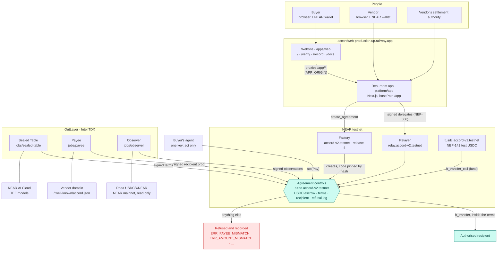
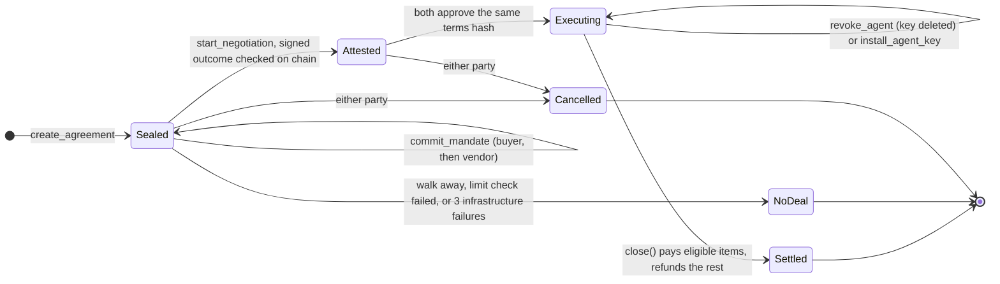
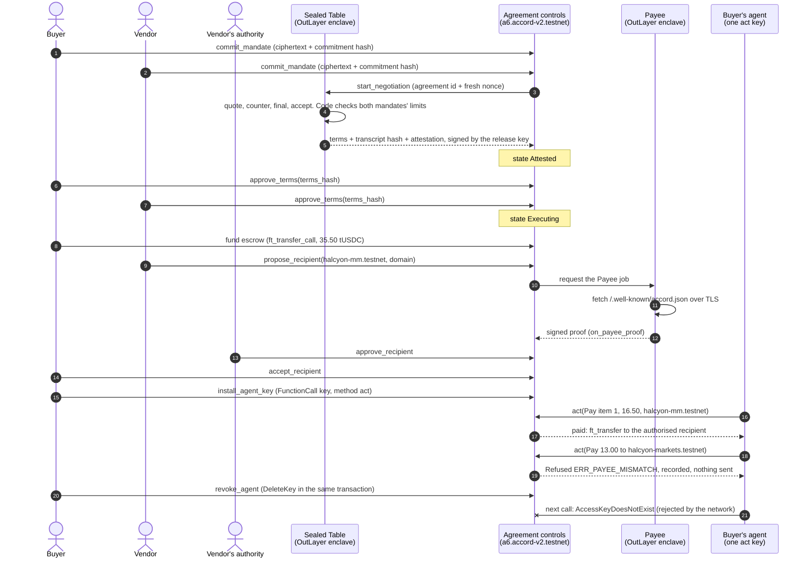
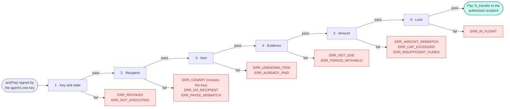

<div align="center">


# Accord

**The private deal room and control plane for agent-to-agent commerce.**

Agreements negotiated in private, enforced in public.

[Site](https://accordweb-production.up.railway.app) ·
[Try a deal](https://accordweb-production.up.railway.app/app/try-it) ·
[Verify](https://accordweb-production.up.railway.app/verify) ·
[Record](https://accordweb-production.up.railway.app/record) ·
[Docs](https://accordweb-production.up.railway.app/docs)

<a href="https://testnet.nearblocks.io/address/accord-v2.testnet"></a>


<a href="LICENSE"></a>

</div>

Two companies' agents negotiate inside an attested enclave from sealed mandates. Both companies approve the terms. From then on, a NEAR contract holds the USDC and refuses any payment the buyer's agent asks for that differs from the approved item, evidence, amount or recipient.

<p align="center">
  <a href="https://accordweb-production.up.railway.app"></a>
</p>

<p align="center">
  <a href="docs/diagrams/accord-architecture.excalidraw">.accord-v2.testnet holds escrowed test USDC, the approved terms, the recipient and the refusal log. OutLayer enclaves (Sealed Table, Payee, Observer) send signed terms, proofs and observations to the agreement; the Sealed Table calls NEAR AI Cloud, Payee reads the vendor's domain, the Observer reads Rhea on NEAR mainnet. The buyer's agent calls act(Pay); inside the terms the agreement pays the authorised recipient, anything else is refused and recorded." width="100%" /></a>
  <br/><sub>The big picture. Source: <a href="docs/diagrams/accord-architecture.excalidraw"><code>docs/diagrams/accord-architecture.excalidraw</code></a> (open it at excalidraw.com).</sub>
</p>

## Contents

1. [The problem](#the-problem)
2. [How it works](#how-it-works)
3. [Try it in 3 minutes on testnet](#try-it-in-3-minutes-on-testnet)
4. [Verify any agreement](#verify-any-agreement)
5. [Use from an agent](#use-from-an-agent)
6. [Testnet proof](#testnet-proof)
7. [Where each attack stops](#where-each-attack-stops)
8. [Claims and their limits](#claims-and-their-limits)
9. [Security audit](#security-audit)
10. [Repository map](#repository-map)
11. [Run locally](#run-locally)
12. [Deployment](#deployment)
13. [Built with](#built-with)

## The problem

Whose server do your agents meet on? When both companies bring an agent, each needs its limits to stay private while the outcome stays binding. The money step is where it breaks today: business email compromise alone cost `$3.05 billion` across `24,768` complaints in 2025 ([FBI IC3 2025 report](https://www.ic3.gov/AnnualReport/Reports/2025_IC3Report.pdf)). Agents read their instructions from the same inbox an attacker can write to. Accord puts the negotiation in an enclave and the payment rules in a contract, so a fooled agent can ask but cannot pay outside the terms.

## How it works

Four parts, named the same in the app, the docs and the code:

| Part | What it does | Code |
| --- | --- | --- |
| Sealed Table | Two agents negotiate inside an OutLayer enclave from mandates sealed in each browser. Code checks every proposal against both mandates' hard limits. Only the terms, commitment hashes, a transcript hash and an attestation leave. | [`platform/jobs/sealed-table`](platform/jobs/sealed-table) |
| Agreement controls | One NEAR account per agreement, code pinned by hash, no full-access key. It holds the USDC escrow and runs `act`, the agent's only method. | [`platform/contracts/agreement`](platform/contracts/agreement) |
| Payee | The vendor proves its domain inside an enclave, its settlement authority approves the account, the buyer accepts it. A change needs all three again and a 24-hour delay in live mode; testnet agreements run in demo mode, where a change waits 120 s and a claim 120 s. | [`platform/jobs/payee`](platform/jobs/payee) |
| Evidence checks | A payment becomes eligible only when the agreed evidence is recorded: delivery accepted, or (market making) enough observations of the venue pass. | [`platform/jobs/observer`](platform/jobs/observer), [`platform/crates/accord-core`](platform/crates/accord-core) |

> The model never decides where money goes. The contract does. The worst a hijacked agent can do is make a payment you already approved, to the recipient you already accepted, when it falls due.

### System architecture



The relayer pays gas for the calls a visitor's wallet signs as NEP-366 delegates (Meteor and Intear send through it); any deposit comes from the user's own account. It never carries `act`: the contract identifies the agent by its signing key, and a relayer's key would replace it.

### Agreement lifecycle



States are the contract's own (`State` in [`platform/crates/accord-core/src/types.rs`](platform/crates/accord-core/src/types.rs)). A refusal never panics: `act` records it, emits the event and returns normally, so the refusal is on the record.

### One deal, end to end

The values are from agreement `a6.accord-v2.testnet` ([proof table](#testnet-proof)).



### The `act()` gates

Authentication comes first (the signing key must be the current agent key or a recently revoked one; anything else panics with `ERR_UNAUTHORIZED` and is not recorded). Then six gates in a fixed order; the first failure is recorded and `act` returns `Refused{code}`.



| Gate | Checks | Refusal codes |
| --- | --- | --- |
| 1. Key and state | The key is not revoked; state is `Executing` | `ERR_REVOKED`, `ERR_NOT_EXECUTING` |
| 2. Recipient | Not a canary (a canary also deletes the key); an active authorised recipient exists; the request names it | `ERR_CANARY`, `ERR_NO_RECIPIENT`, `ERR_PAYEE_MISMATCH` |
| 3. Item | The item exists and is unpaid | `ERR_UNKNOWN_ITEM`, `ERR_ALREADY_PAID` |
| 4. Evidence | Delivery accepted (or the window lapsed undisputed); for market making, the period closed `Eligible`; or an approved exception waives it | `ERR_NOT_DUE`, `ERR_PERIOD_WITHHELD` |
| 5. Amount | Equals the item amount (or its approved exception); stays within the total; the escrow covers it | `ERR_AMOUNT_MISMATCH`, `ERR_CAP_EXCEEDED`, `ERR_INSUFFICIENT_FUNDS` |
| 6. Lock | No payment in flight | `ERR_IN_FLIGHT` |

Source: [`platform/ARCHITECTURE.md`](platform/ARCHITECTURE.md) section 6. Five refusals by the same key inside an hour revoke it automatically.

## Try it in 3 minutes on testnet

> [!NOTE]
> The app is live at https://accordweb-production.up.railway.app/app/try-it (since 9 Nov 2026). The transactions below show this exact path run on 8 Nov 2026, and [Verify any agreement](#verify-any-agreement) works with no account. To run the page yourself instead, start the app ([Run locally](#run-locally)) and open http://localhost:3100/app/try-it; the faucet, demo counterparty and demo agent need the `FAUCET_*`, `DEMO_*` and `RELAYER_*` variables named in [`platform/.env.example`](platform/.env.example).

Open [`/app/try-it`](https://accordweb-production.up.railway.app/app/try-it). Everything there is NEAR testnet with test USDC. The vendor in your room is Accord's demo vendor (`halcyon-demo.testnet`, authority `halcyon-auth.testnet`) and the agent is a demo agent run by Accord for test rooms; both are labelled in the room.

| # | Do | See |
| --- | --- | --- |
| 1 | **Connect a NEAR wallet**: a NEAR testnet wallet such as Meteor or Intear | `01 Connect a wallet` marked done, with your account |
| 2 | **Get test funds** | `0.00 NEAR` becomes `2.50 NEAR · 100.00 tUSDC`, both faucet transactions linked |
| 3 | **Create the room** | `Your room is a8.accord-v2.testnet: My first deal room.` (your number will differ) |
| 4 | **Seal your mandate** with the Northwind preset (`40` tUSDC ceiling, 2 to 4 items) | In the Demo counterparty panel: `Sealed the vendor's mandate (Halcyon procurement preset)`, then `Started the negotiation in the Sealed Table`; the state moves `Sealed` to `Attested` |
| 5 | Approve the terms and fund the escrow; accept the recipient; accept delivery 1 | `Approved the terms as the vendor`, `Proposed halcyon-mm.testnet as the recipient on accordweb-production.up.railway.app`, `Submitted delivery for item 1` |
| 6 | **Start the demo agent** (your wallet signs `install_agent_key`), then **Let the agent pay the due item** | `Paid item 1: 15.00 tUSDC to halcyon-mm.testnet, the active recipient.` |
| 7 | **Ask the agent to pay a new account** | `ERR_PAYEE_MISMATCH` and `Asked to pay … to halcyon-markets.testnet. The contract refused it and recorded the refusal.` |
| 8 | Revoke the key from the room header | `Agent revoked · next call rejected by the network` |

<p align="center">
  
  &nbsp;&nbsp;
  
  <br/><sub>The demo agent's panel: a payment inside the terms, then a redirect the contract refused.</sub>
</p>

<details>
<summary>The same path, run with a fresh account on 8 Nov 2026 (agreement <code>a8.accord-v2.testnet</code>)</summary>

| Step | Transaction |
| --- | --- |
| Faucet, NEAR | [`935XqMoe…`](https://testnet.nearblocks.io/txns/935XqMoeb4Jt7fBQQHK9T7o9ZWJrWUoZYYCkdPGqhBoa) |
| Faucet, tUSDC | [`3t7SSAkT…`](https://testnet.nearblocks.io/txns/3t7SSAkTzQt7Aj2d6FwkhpG7BzKfC2mhCcWMR2E46PQ3) |
| Create | [`5xdpHZTz…`](https://testnet.nearblocks.io/txns/5xdpHZTzQyjFiZcxApbwPDH2o3DQNKYhE9szxfjAjgDq) |
| Negotiation started | [`HFk6XgoF…`](https://testnet.nearblocks.io/txns/HFk6XgoFmkZt2mDBrtE3zzD4mXPMEQUKnVyTGwqi9143) |
| Fund | [`91knP5Ez…`](https://testnet.nearblocks.io/txns/91knP5EzbKV5ajEXdfETkCXJqucQ5niJoPLBF2dbipng) |
| Agent pays item 1 | [`HxYDHTRL…`](https://testnet.nearblocks.io/txns/HxYDHTRLteGfGYoeEptehVMKbFgBdVWBqrejUJhsjSnb) |
| Redirect refused | [`37zUgEoe…`](https://testnet.nearblocks.io/txns/37zUgEoe8jbqnqQQhSe8L1VPBMRrrqXdsDorgDY7cEYL) |
| Revoke | [`F67Qcofq…`](https://testnet.nearblocks.io/txns/F67Qcofq9CmVuGze7URoVD3E1HfucQ7qooBjDJjANHiG) |

The server side is [`platform/app/src/server/demo.ts`](platform/app/src/server/demo.ts): the faucet sends only what an account lacks, once a day per account and per IP; the counterparty reads the room and makes the vendor's next valid move, so calling it twice does nothing twice; the demo agent's key is derived per room and signs `act` itself, never through the relayer.

</details>

### Settle in Circle USDC (testnet)

A second factory, `accord-usdc.testnet`, runs the same code as `accord-v2.testnet` (release 3 at first, release 4 since 9 Nov 2026; the same job builds and keys) and settles in Circle's USDC on NEAR testnet, `3e2210e1184b45b64c8a434c0a7e7b23cc04ea7eb7a6c3c32520d03d4afcb8af` (6 decimals). Each agreement copies its factory's token at creation and keeps it for life, so `a<n>.accord-usdc.testnet` takes only Circle USDC and `a<n>.accord-v2.testnet` only test USDC. `/app/try-it` defaults to test USDC from the app's faucet; Circle USDC is offered next to it where the server sets `ACCORD_FACTORY_USDC`.

| Do | See |
| --- | --- |
| Get Circle testnet USDC at https://faucet.circle.com, network `NEAR Testnet`, your account as the address | about `20 USDC` per address every 1 to 2 hours |
| `make verify-usdc DEAL=a1.accord-usdc.testnet` (the same as `ACCORD_FACTORY=accord-usdc.testnet make verify`) | `code hash 8wMuMRre… = release 3 (global by hash)` · `keys from pubkey run 13909` · `verify: 5 checks ok · 1 partial · 1 not checked` |
| `make negotiate-usdc`, then `make finish-usdc DEAL=<agreement>` once the buyer holds the terms' total | the same blocks as `make negotiate` and `make finish`, with Circle USDC; the presets fit one faucet drip (buyer ceiling `18`, vendor floor `12`) |

`a1.accord-usdc.testnet` (release 3) was negotiated on 9 Nov 2026 (`14.00 USDC` in 3 items, `QUOTE → COUNTER → ACCEPT`, glm-5.3-flash in OutLayer's enclave), approved, funded, paid `5.00` and refused a redirect, then revoked: [Circle USDC proof](#circle-usdc). Transactions: `platform/DECISIONS.md` sections 24 and 26.

## Verify any agreement

No account and no keys.

| Where | Do | See |
| --- | --- | --- |
| Browser | Open [/verify](https://accordweb-production.up.railway.app/verify) and enter an agreement, e.g. `a6.accord-v2.testnet` | Each public check with its result and the transaction behind it |
| Browser | Open [/record](https://accordweb-production.up.railway.app/record) | Agreement `a6`'s 12 steps, each linked to its transaction |
| Terminal | The commands below | `verify: 5 checks ok · 1 partial · 1 not checked` |

```bash
git clone https://github.com/Adityaakr/accord.git && cd accord/platform
corepack enable && pnpm install
ACCORD_FACTORY=accord-v2.testnet make verify DEAL=a6.accord-v2.testnet
```

<details>
<summary>Output, from a run on 9 Nov 2026</summary>

```
accord verify · a6.accord-v2.testnet
  code      code hash 8wMuMRre… = release 3 (global by hash) · no deploy method · ok
  keys      0 key · none · no full access · ok
  sealed    outcome signature ok · commitments match · agreement matches · ok
  release   sealed-table wasm 7c832ce9… · keys from pubkey run 13682 · OutLayer attestation record not checked here (needs outlayer-verify) · not checked
  model     z-ai/glm-5.3-flash · attestation report fetched with fresh nonce f9e049d1… · nonce bound in the report · hardware quote and GPU evidence not checked here (make probe-ai checks them) · partial
  payee     halcyon-mm.testnet · proof accordweb-production.up.railway.app signed by the release's payee key · authority approved · buyer accepted · active · ok
  record    1 payments · 1 refusals (1 in the log) · 0 exceptions · 0 set aside · 0 observation conflicts · receipts match paid · ok
verify: 5 checks ok · 1 partial · 1 not checked
```

The nonce is fresh on every run. `model` is `partial`: the report is fetched with that nonce and the nonce is bound in it, but the hardware quote and GPU evidence are not checked by `make verify` (`make probe-ai` checks them, with a NEAR AI key). `release` is `not checked` until the `outlayer-verify` tool is installed ([`platform/docs/build/BLOCKED.md`](platform/docs/build/BLOCKED.md)). `keys` reads `0 key` because a6's agent was revoked.

</details>

## Use from an agent

Everything below reads NEAR testnet with no account and no keys. Run it from `platform/` after `corepack enable && pnpm install`.

**MCP server** (`@accord/mcp`, stdio by default). With no key in the environment it serves 7 read-only tools: `accord_list_agreements`, `accord_get_agreement`, `accord_due_items`, `accord_preflight`, `accord_refusals`, `accord_receipts` and `accord_verify`. The paying and principal tools appear only when their keys are set ([`platform/INTERFACES.md`](platform/INTERFACES.md) section 12).

```bash
ACCORD_FACTORY=accord-v2.testnet pnpm --silent --filter @accord/mcp dev            # stdio
ACCORD_FACTORY=accord-v2.testnet pnpm --silent --filter @accord/mcp dev -- --http 3333   # streamable HTTP at http://127.0.0.1:3333/mcp
```

On start it prints `accord-mcp · 7 tools · agent off · principal off` on stderr. An MCP client config runs the first command with `cwd` set to `platform/`.

**CLI** (`accord`; read-only commands need no key):

```bash
ACCORD_FACTORY=accord-v2.testnet pnpm --silent --filter @accord/cli dev -- show --agreement a6.accord-v2.testnet
ACCORD_FACTORY=accord-v2.testnet pnpm --silent --filter @accord/cli dev -- receipts --agreement a6.accord-v2.testnet --json
```

**SDK** (`@accord/sdk`, TypeScript on `near-api-js`; build it once with `pnpm --filter @accord/sdk build`):

```ts
import { Accord, verify } from "@accord/sdk";
const accord = new Accord({ network: "testnet", factory: "accord-v2.testnet" });
const report = await verify(accord, "a6.accord-v2.testnet"); // { checks: [{ name, status, detail }], ok, partial, failed, notChecked }
```

**HTTP**: the live app returns the same report as JSON, with a nonce you choose (64 hex characters) or one it generates:

```bash
curl -s https://accordweb-production.up.railway.app/app/api/verify/a6.accord-v2.testnet
```

An account that is not an Accord agreement answers `404` with `{"error":"<account> is not an Accord agreement"}` once the app runs this commit. The site also serves [/llms.txt](https://accordweb-production.up.railway.app/llms.txt) and [/facts.json](https://accordweb-production.up.railway.app/facts.json).

## Testnet proof

Agreement [`a6.accord-v2.testnet`](https://testnet.nearblocks.io/address/a6.accord-v2.testnet) ran the full flow on 8 Nov 2026, on release 3 of factory `accord-v2.testnet`. It is the original walkthrough; the proofs on release 4 and in Circle USDC follow it. The Sealed Table negotiation used the real NEAR AI model (`z-ai/glm-5.3-flash`) inside OutLayer's attested enclave: `QUOTE → COUNTER → FINAL → ACCEPT`, `35.50` tUSDC in 3 items. Settlement is a test USDC token.

| # | Step | Transaction |
| --- | --- | --- |
| 01 | Buyer seals its limits | [`Ek9Zr1wj…`](https://testnet.nearblocks.io/txns/Ek9Zr1wjD6nrWaKHFak8UDv5Jwbaacqrdh1huNp6qwAk) |
| 02 | Vendor seals its limits | [`2Zq8pfNo…`](https://testnet.nearblocks.io/txns/2Zq8pfNoa1dFzMLAy79aGyek72q3LGcrvRqAjYABisKZ) |
| 03 | Negotiated in the enclave: `35.50 USDC · 3 items` | [`GfX5qKq3…`](https://testnet.nearblocks.io/txns/GfX5qKq35rvtUVkp9nBPgw3kkzDSXx6hfY2H5cb3wfHW) |
| 04 | Buyer approves the terms | [`H6cMyE6k…`](https://testnet.nearblocks.io/txns/H6cMyE6kzs9SdrC4yaP7CvnDxJqH4NSx7ivKeu2rBHSg) |
| 05 | Vendor approves the terms (state `Executing`) | [`2uv8tTfe…`](https://testnet.nearblocks.io/txns/2uv8tTfeYhe2aZ5cMrVNfFzr88kPL4HeSxwYzNhtmveT) |
| 06 | Buyer funds the escrow: `35.50 USDC` | [`2CeFB18j…`](https://testnet.nearblocks.io/txns/2CeFB18jenw2iggWE8mQZy9DehwZ2f97TYXwi3RVeXPy) |
| 07 | Recipient proven in the enclave (Payee) | [`6koRbw5Q…`](https://testnet.nearblocks.io/txns/6koRbw5QDYTgVU52Fe1vH755QGLPwZabQhF1kTk5rup6) |
| 08 | Vendor's authority approves | [`FBQnqtKX…`](https://testnet.nearblocks.io/txns/FBQnqtKXs5B5zn1A4F1yCDUmACYMqsi2zM2uez6YxDis) |
| 09 | Buyer accepts `halcyon-mm.testnet` | [`3d3LSZvz…`](https://testnet.nearblocks.io/txns/3d3LSZvz3yPX5LM1Bk6t9bxiX2x1JDMEt9mfa2fbw11p) |
| | Agent key installed | [`EUJ86tSV…`](https://testnet.nearblocks.io/txns/EUJ86tSVNuYsgtMVYYZZ9CYbsJmY6jCKm1Uew5doPU1C) |
| 10 | Agent pays inside the terms: `16.50 USDC` to `halcyon-mm.testnet` | [`2k57zg7i…`](https://testnet.nearblocks.io/txns/2k57zg7iE44muCGRbcc2JTVmy5uGHHyCePXNPmcWCKEQ) |
| 11 | Redirect to `halcyon-markets.testnet` refused: `ERR_PAYEE_MISMATCH`, nothing sent | [`AB9HLnWv…`](https://testnet.nearblocks.io/txns/AB9HLnWvkzNL418ygx8AVArinPnAK3jqxt4haAjsk8fs) |
| 12 | Buyer revokes the agent; its next call fails with `AccessKeyDoesNotExist` | [`4ervNQdj…`](https://testnet.nearblocks.io/txns/4ervNQdjrd7MA1n7vWSY7cRUtCpwiQwSK7xDSK2Bmn9P) |

### Release 4 (audit fixes)

The audited agreement code (`ECgsrZwy…`, global contract `R2qxw4u5…`) is release 4 on both factories since 9 Nov 2026: `accord-v2.testnet` ([publish](https://testnet.nearblocks.io/txns/EB2Lz3WF1Pqt4o9y9NzUF5uc9qEhimPAPLKdwJFwvqnU), [set current](https://testnet.nearblocks.io/txns/J9uADVqQSkY6f1uMYbMbWoPnB4oiwuS3CtLayKojtgeC)) and `accord-usdc.testnet` ([publish](https://testnet.nearblocks.io/txns/GovfwhMAtB28ayEndYmtiZHEo8sq9YhKVCXj8m3WFaai), [set current](https://testnet.nearblocks.io/txns/5D9LxPuU4phUXTgRawd97TmhZPGiPjWzSPWCYXJteoLJ)). Agreements created before keep release 3 (code pinned by hash), so a6 above is unchanged. The proofs ran again on new release 4 agreements of `accord-v2.testnet` (test USDC):

| Proof | Agreement | Result | Transaction |
| --- | --- | --- | --- |
| Negotiate | [`a10`](https://testnet.nearblocks.io/address/a10.accord-v2.testnet) | Attested in 64 s, `33.00 USDC` in 3 items, attestation ok, `ERR_SEALED` both ways | in the `make negotiate` output |
| Fund | `a10` | `33.00 USDC` escrowed | [`2mBhRNnX…`](https://testnet.nearblocks.io/txns/2mBhRNnXnitEN2gefBe7C8MWdCYS7P2nJLZyZznHFH22) |
| Pay | `a10` | item 1, `12.00 USDC` to `halcyon-mm.testnet` | [`Bs5dVpr6…`](https://testnet.nearblocks.io/txns/Bs5dVpr6DnR5jXjYKXbGsp9HP36smmoJRFmvJP4tGqAm) |
| Redirect refused | `a10` | `ERR_PAYEE_MISMATCH` | [`51TQ8no9…`](https://testnet.nearblocks.io/txns/51TQ8no9kPp4P8SDyN77jNZMevLsKaTBH3SufU2SUefu) |
| Attack | [`a11`](https://testnet.nearblocks.io/address/a11.accord-v2.testnet) | `ERR_PAYEE_MISMATCH`, `ERR_AMOUNT_MISMATCH`, `ERR_CANARY` revokes and deletes the key; `0.00` moved | [`HvwpdKDs…`](https://testnet.nearblocks.io/txns/HvwpdKDs64sA5zuj37iK8B1N1kKDadh4VoeU8n3LwMSv), [`3cTDxHzV…`](https://testnet.nearblocks.io/txns/3cTDxHzVH29Uiw6kZceFmuuUkhnBiBp5JYW65bsewLvh), [`DPpVoMX9…`](https://testnet.nearblocks.io/txns/DPpVoMX9KKYXppXvrM6HqorDYsDd9ndQy8YniKDvMsXT) |
| Revoke | [`a13`](https://testnet.nearblocks.io/address/a13.accord-v2.testnet) | `DeleteKey`; the next call fails with `AccessKeyDoesNotExist`; a new key pays item 2 | [`8b8FC1He…`](https://testnet.nearblocks.io/txns/8b8FC1HeiHCTJcUaga87zWuNCg6LTgYGYDzRptdHh2H3), [`DfgMURQA…`](https://testnet.nearblocks.io/txns/DfgMURQANtnBq2LziGaELXabw9tvzqhYQXq71hXjzNDT), [`24mdebXg…`](https://testnet.nearblocks.io/txns/24mdebXgCkMZFyekdDyxv3YQzJS1iaxckrfnN2aRY9Fe) |
| Verify | `a10` | `code = release 4` · `5 ok · 1 partial · 1 not checked` | `ACCORD_FACTORY=accord-v2.testnet make verify DEAL=a10.accord-v2.testnet` |

The first `make revoke` run (a12) stopped at its last step: the script paid item 2 at a fixed `12.00` while the negotiated amount differed, and the contract refused it with `ERR_AMOUNT_MISMATCH`. The live targets now pay each item at its negotiated amount.

### Circle USDC

Agreement [`a1.accord-usdc.testnet`](https://testnet.nearblocks.io/address/a1.accord-usdc.testnet), created on release 3 of the second factory, ran a deal in Circle's testnet USDC on 9 Nov 2026:

| Step | Result | Transaction |
| --- | --- | --- |
| Fund | `14.00 USDC` (Circle) escrowed | [`4gPohYYM…`](https://testnet.nearblocks.io/txns/4gPohYYMokgQcPcgNhX3tCTTXjA35AfuKkpGs1SpS2no) |
| Pay | `5.00 USDC` to `halcyon-mm.testnet` | [`E127BGy3…`](https://testnet.nearblocks.io/txns/E127BGy3Tw6PmhE9JcoFr7vQsKTiHNevTTiAxEjJGWK2) |
| Redirect refused | `ERR_PAYEE_MISMATCH` | [`9rgsBFA2…`](https://testnet.nearblocks.io/txns/9rgsBFA26yedWuEEJk77sKBDrDGS9mHn9BFMknCaP8BB) |
| Revoke | the agent's next call fails with `AccessKeyDoesNotExist` | [`FTigDebs…`](https://testnet.nearblocks.io/txns/FTigDebs1kZjLpTN8nC8SZWp4dMM1ChuUyR211JZnzuW) |
| Verify | release 3 · `5 ok · 1 partial · 1 not checked` | `make verify-usdc DEAL=a1.accord-usdc.testnet` |

| Infrastructure | Account or link |
| --- | --- |
| Factory | [`accord-v2.testnet`](https://testnet.nearblocks.io/address/accord-v2.testnet), release `4` ([publish tx](https://testnet.nearblocks.io/txns/EB2Lz3WF1Pqt4o9y9NzUF5uc9qEhimPAPLKdwJFwvqnU)); release `3` ([publish tx](https://testnet.nearblocks.io/txns/7m8pj7u2D5aAXJ3RPbPWkhShKpJxwWHhPSpRrKr9nPVh)) for a6 |
| Circle USDC factory | [`accord-usdc.testnet`](https://testnet.nearblocks.io/address/accord-usdc.testnet), release `4` ([publish tx](https://testnet.nearblocks.io/txns/GovfwhMAtB28ayEndYmtiZHEo8sq9YhKVCXj8m3WFaai)); token `3e2210e1…afcb8af` (Circle USDC, 6 decimals) |
| Test USDC | [`tusdc.accord-v1.testnet`](https://testnet.nearblocks.io/address/tusdc.accord-v1.testnet) (NEP-141, 6 decimals) |
| Relayer | `relay.accord-v2.testnet` ([a relayed tx](https://testnet.nearblocks.io/txns/DyFrt2v9sGhxnRiWVwSydXPWS48exUis56YydCMmrBhC)) |
| OutLayer jobs | Sealed Table, Payee and observer, as OutLayer projects `accord-v1.testnet/accord-{sealed-table,payee,observer}`; release 3 pubkey runs `13682`, `13672`, `13683` |
| NEAR AI Cloud attestation | [testnet-api.outlayer.ai/attestations/13596](https://testnet-api.outlayer.ai/attestations/13596) |
| Demo accounts | vendor `halcyon-demo.testnet`, authority `halcyon-auth.testnet`, recipient `halcyon-mm.testnet` |
| Demo vendor's domain | `accordweb-production.up.railway.app`, Accord's own site, serving the Payee file ([`/.well-known/accord.json`](https://accordweb-production.up.railway.app/.well-known/accord.json)) for Halcyon, a fictional company. A real vendor serves the same file on its own domain |

Sources: [`apps/web/src/content/testnet.ts`](apps/web/src/content/testnet.ts) and [`platform/DECISIONS.md`](platform/DECISIONS.md) sections 21, 24 and 26. Market-making agreements run end to end on a local node; on testnet they wait on an OutLayer payment key ([`platform/docs/build/BLOCKED.md`](platform/docs/build/BLOCKED.md)).

## Where each attack stops

<p align="center">
  <a href="docs/diagrams/accord-attacks.excalidraw"></a>
  <br/><sub>Source: <a href="docs/diagrams/accord-attacks.excalidraw"><code>docs/diagrams/accord-attacks.excalidraw</code></a>. The full threat model is <a href="platform/ARCHITECTURE.md"><code>platform/ARCHITECTURE.md</code></a> section 16.</sub>
</p>

**What the agent's key can and cannot do.** It can call one method, `act`, on one account: the agreement it works for. It cannot attach NEAR, transfer NEAR, add or delete keys, deploy code, delete the account, or call any other contract. It spends gas from a fixed allowance (`0.5 NEAR` by default). One buyer transaction, `revoke_agent`, ends it.

## Claims and their limits

Verbatim from [`platform/GOAL.md`](platform/GOAL.md). Every public statement about Accord is one of these, stated with its limit.

| We claim | Because | Limit, stated next to it |
| --- | --- | --- |
| Each company's mandate is readable only inside attested enclaves | The browser encrypts the mandate to a key derived from a seed generated inside the Sealed Table's enclave, bound to its release build and readable only by runs an agreement requests or that publish the key's public half; the chain holds the ciphertext and a commitment hash; the two negotiators run on NEAR AI Cloud models in TEEs, and the gateway's and the model's attestations are verified with a fresh nonce | Under the hardware's trust assumptions (Intel TDX, NVIDIA confidential computing) and OutLayer's keystore governance. The deployer owns the seed and the factory account, and could rebind the seed to another build or request extra runs. On testnet the job's seed condition admits any caller during an agreement's open request window, so an outside party could request extra runs then and learn bounds on the limits; restricting the seed to the agreement's own calls is the next step. Prompts reach the model through NEAR AI's attested gateway over TLS (TLS binding is not checked from inside the job), unless end-to-end encryption to the model shipped (2.3b). The browser trusts the code the app serves; the CLI is the alternative. The ciphertext stays on chain. The final terms reveal that each side accepted them, as any signed deal does. A negotiator can concede in words; code checks the numbers |
| The approved terms are the agent's only authority | The agent's only key is a function-call key on the agreement's own account that can call `act` and nothing else; `act` refuses any payment whose item, evidence, amount or recipient differs from the terms both companies approved | The agent's judgement is bounded, not protected: it can still be fooled into asking. Attestation proves which code produced the terms, not that the deal was good; people decide that when they approve |
| Payments go only to the authorised recipient | The recipient is a NEAR account listed in a file on the vendor's domain, fetched inside an enclave; the vendor's settlement authority approves it on chain and the buyer accepts it; a change needs all three again and a 24-hour delay | Authorisation proves control of the domain and the authority's approval, not that the company legally exists. A legal KYB check is a later integration. Testnet agreements run in demo mode: a recipient change waits 120 s and a claim 120 s; live mode enforces at least 24 h for a recipient change and 72 h for a claim, checked by the factory and again by the agreement |
| Revoking ends the agent's authority in one transaction | `revoke_agent` marks the agent's key revoked, so the contract refuses it from that receipt on, and deletes it from the agreement account in the same transaction; the account has no other key, so after the deletion lands (about one block) anything the agent signs is rejected by the network before it reaches the contract | A payment already made stays made, and it went to the authorised recipient at the approved amount. A call that reached the chain before the revoke still runs, with every check. Revoking never cancels what the vendor has earned: an eligible payment stays claimable by the vendor |
| Negotiation is private; settlement is public | Mandates and the transcript stay inside enclaves; only the terms, commitment hashes, a transcript hash and attestation references leave; the commercial terms document is encrypted to the two parties | The enforced schedule (amounts, dates, recipient) and every payment are public on NEAR, as with any stablecoin payment |
| A market-making agreement's payment becomes eligible only when the agreed observations pass, unless the buyer approves an exception | Each slot's time is drawn inside the observer's enclave from a seed generated there; the observation is taken at the first NEAR mainnet block after that time, signed by the observer's key, and checked by the contract against the agreed spread, depth and two-sided quoting; anyone can recompute it from an archival node | A market-making agreement's observer measures the venue's liquidity, not the market maker's own orders. The deployer owns the observer's seed and could rebind it to a build that reveals slot times in advance. A slot nobody polls in time counts as unobserved, and a period that unobserved slots leave undecided, or that has conflicting observations, goes to the buyer, not to payment |

The site's [/security](https://accordweb-production.up.railway.app/security) page shows the same table.

## Security audit

Five independent audit lenses (the payment path; authorisation and keys; creation and code integrity; funds; the enclave jobs), with two skeptics reproducing each finding as a test, found 1 High and 5 Medium issues (one of them Medium-Low), plus 4 Low. The High one was a close-refund drain: a deposit sent during `close` could make the refund to the buyer spend the vendor's reserve; the refund is now capped at the ledger while anything is owed to the vendor. Every fix went in test first (the test failed for the reason named, then passed) and the tests stay in the suite. The contract and factory fixes are live as release 4 on both testnet factories ([proofs](#release-4-audit-fixes)).

Limit: S1 (only an agreement's own calls can use the Sealed Table's seed) is partial. The jobs now serve only factory agreements in code, but those job builds are not deployed yet (release 4 runs release 3's job builds), and S1 itself needs the seed's access condition in OutLayer, which only its dashboard can set and which is not set yet. Every finding, fix, test and commit: [`platform/DECISIONS.md`](platform/DECISIONS.md) section 25.

## Repository map

```
.
├── apps/web/                 the website (Vite + React, prerendered); serves /app by proxy
│   ├── src/                  pages, sections, components, content (testnet.ts: every proof tx)
│   ├── public/               static assets, docs screenshots
│   ├── seo/                  facts.mjs and per-page snapshots for llms.txt and JSON-LD
│   └── scripts/              serve.mjs (production server), prerender, copy and reference checks
├── platform/                 the product (pnpm + Cargo workspace); its own README
│   ├── app/                  the deal-room app (Next.js, basePath /app)
│   ├── contracts/            agreement, factory, releases (keyless), test-token, probe-keys
│   ├── crates/               accord-core (pure rules, the six gates), accord-jobkit, accord-venue
│   ├── jobs/                 sealed-table, payee, observer (OutLayer, wasm32-wasip2)
│   ├── packages/             sdk, cli, mcp, live (the make targets), store
│   ├── services/             agent (demo agent and /try re-arm), keeper
│   ├── tests/                sandbox suite on a local NEAR node
│   ├── fixtures/             fictional companies, inbox messages, job fixtures
│   ├── scripts/              setup, wasm build, deploy, dev
│   └── *.md                  GOAL, ARCHITECTURE, INTERFACES, DECISIONS, PROGRESS, DEPLOY, CLAUDE
├── docs/
│   ├── diagrams/             Excalidraw sources with SVG and PNG exports
│   ├── product/              a pointer to the product kit in platform/
│   └── hackathon/            the organisers' HACKATHON.md
├── AGENTS.md, CLAUDE.md     notes for evaluating agents: layout, judge paths, where the claims are
├── .github/workflows/ci.yml  website: typecheck, copy rules, references, build
├── Dockerfile, railway.json  the website's Railway build
└── package.json              npm workspace for apps/*
```

## Run locally

### The website

Needs Node `22` (`.nvmrc`; `package.json` asks for `>=20.19`).

| Do | See |
| --- | --- |
| `npm ci` | Dependencies for the `apps/*` workspace |
| `npm run dev` | Vite on http://localhost:5180 |
| `npm run check` | Typecheck, then `check-copy: clean` and the reference check |
| `npm run build` | `tsc -b`, `vite build`, then the prerender into `apps/web/dist` |
| `npm start` | `apps/web/scripts/serve.mjs` serving `dist` on `$PORT` (default `5180`), with `/healthz` |
| `APP_ORIGIN=http://localhost:3100 npm start` | `/app` and `/app/*` proxied to a local app; without `APP_ORIGIN`, `/app` shows a "starting up" page |

### The app and the contracts

Needs Node `>=22`, pnpm `10.30.2` (`corepack enable`), and for contracts and jobs the Rust toolchain in `platform/rust-toolchain.toml` (`1.97.0`, with `wasm32-unknown-unknown` and `wasm32-wasip2`). `make setup-check` lists each tool with its version and `ok`, or the install command.

```bash
cd platform
corepack enable && pnpm install
```

| Do | See |
| --- | --- |
| `pnpm --filter @accord/app dev` | The app at http://localhost:3100/app, reading testnet (`accord-v2.testnet` by default). The faucet, demo counterparty and relayer need the variables in `platform/.env.example` |
| `make dev` | A local NEAR node with the real contracts, the three jobs' own code run natively (only the model is replaced, labelled `model.local`), a test USDC faucet, the keeper, the demo agent and the app at http://localhost:3100 |
| `make sandbox` | The full procurement flow and one market-making period on a local sandbox, mocked steps marked `[mock]`, ending `sandbox: all checks passed` |
| `make test` | `cargo test` for the workspace, then the package, service and app tests |
| `make attack NET=local` | `ERR_PAYEE_MISMATCH`, `ERR_AMOUNT_MISMATCH`, `ERR_CANARY` with the key revoked and deleted, then `AccessKeyDoesNotExist`, and `0.00 USDC moved by attempts` |
| `make demo NET=local` | The whole loop from fresh accounts (14 s on 3 Nov 2026) |
| `make market-making NET=local` | Two market-making agreements on Rhea's USDC/wNEAR pool, observed at real mainnet blocks: one period `Eligible` and paid, the stricter one `Withheld` and refused `ERR_PERIOD_WITHHELD` |

Every live target (`negotiate`, `approve`, `fund`, `payee`, `pay`, `attack`, `revoke`, `claim`, `exception`, `payee-change`, `market-making`, `demo`, `inbox`) runs against testnet without `NET=local`, using the accounts and keys named in `platform/.env.example`. Their printed lines are defined in [`platform/INTERFACES.md`](platform/INTERFACES.md) section 10; recorded runs are in [`platform/README.md`](platform/README.md).

## Deployment

Two Railway services from this repository, one public address:

| Service | Root | Build | Health check |
| --- | --- | --- | --- |
| Website | repository root | [`Dockerfile`](Dockerfile) via [`railway.json`](railway.json) | `/healthz` |
| App | `platform` | [`platform/Dockerfile`](platform/Dockerfile) via [`platform/railway.json`](platform/railway.json) | `/app/api/status` |

The website's `APP_ORIGIN` points at the app service, and `serve.mjs` forwards `/app/*` to it. Variable names and steps are in [`platform/DEPLOY.md`](platform/DEPLOY.md). No key is built into either image; every secret is a runtime variable.

## Built with

| | Used for |
| --- | --- |
| NEAR | The agreement contract, its escrowed USDC and the record of every payment and refusal: function-call access keys, sub-accounts with code pinned by hash (NEP-591), NEP-141, NEP-145, NEP-297 events, NEP-413, NEP-366 |
| [NEAR AI Cloud](https://cloud.near.ai) | Private inference for the negotiating agents, with attestations fetched with a fresh nonce |
| [OutLayer](https://app.outlayer.ai/docs/getting-started) | Intel TDX enclaves for the Sealed Table, Payee and the observer |
| USDC on NEAR | Settlement as a NEP-141 token (`tUSDC` on testnet) |
| Rhea | The USDC/wNEAR pool the market-making observer reads, read only |
| Libraries | near-sdk `5.30.0`, near-contract-standards `5.30.0`, near-api-js `7.3.1`, eciesjs, canonicalize, @noble, Next.js `16`, HOT Connect (`@hot-labs/near-connect`, wallet sign-in), the MCP TypeScript SDK; the website on React `19` and Vite `7` |

No partnership is claimed. Built for NEAR HACKATHON (development closes 14 Nov 2026). Licence: [MIT](LICENSE).
