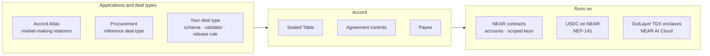
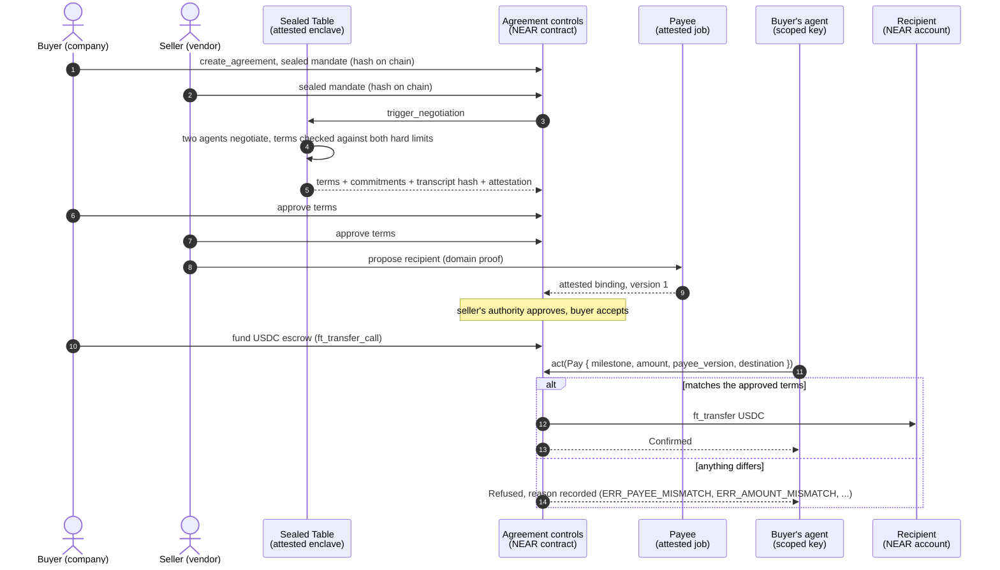
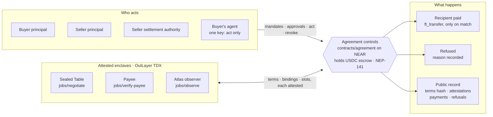
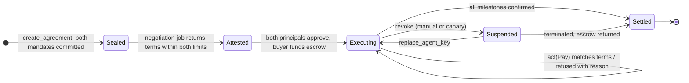
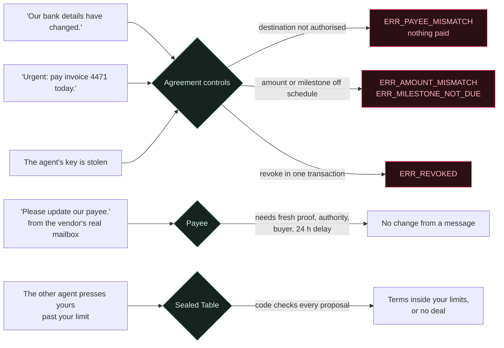
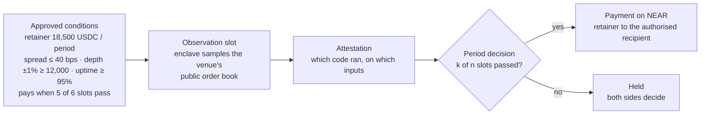
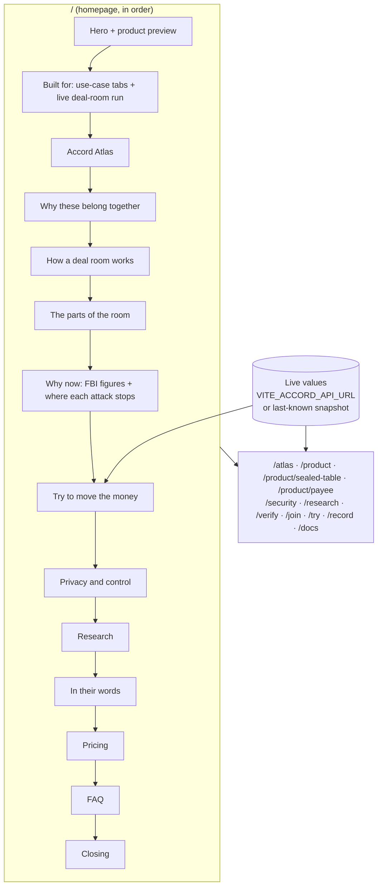

<div align="center">

# Accord

### The private deal room and control plane for agent-to-agent commerce.

Two companies' agents negotiate in confidence. Both companies approve the terms.<br/>
From then on, those terms are the only authority the buyer's agent has over money.

**Best for** market-making retainers · vendor contracts and invoices · treasury payouts · selling to AI agents · agent-to-agent services

</div>

**Built for commerce in stablecoins**

| Use case | What the agreement enforces | Money moves when |
| --- | --- | --- |
| **Market-making retainers** | The spread, depth and uptime both sides agreed | Attested order-book observations pass (Accord Atlas) |
| **Vendor contracts and invoices** | Invoices matched to approved orders; duplicates, overcharges and changed bank details refused | The buyer accepts the delivery |
| **Treasury payouts** | Grants and recurring payouts, only to authorised recipients | Each milestone report is accepted |
| **Selling to AI agents** | Deals with buyers' agents, funded before work starts | The agreement is funded, then on schedule |
| **Agent-to-agent services** | Usage priced and settled between agents, within agreed caps | On schedule, until revoked |

**Accord Atlas, the first application on Accord:** liquidity agreements with measurable payment conditions. A market maker's retainer is released only when the agreed spread, depth and uptime are measured on the venue. [How Atlas works →](#accord-atlas)

<div align="center">

[](https://github.com/Adityaakr/accord/actions/workflows/ci.yml)


[](LICENSE)

[What it is](#what-accord-is) ·
[How it works](#how-it-works) ·
[Architecture](#architecture) ·
[Accord Atlas](#accord-atlas) ·
[Claims and limits](#claims-and-their-limits) ·
[Repository](#repository-layout) ·
[Run it](#getting-started) ·
[References](#references)

</div>

---

## Contents

1. [What Accord is](#what-accord-is)
2. [Why now](#why-now)
3. [How it works](#how-it-works)
4. [Architecture](#architecture)
5. [The agreement lifecycle](#the-agreement-lifecycle)
6. [Where each attack stops](#where-each-attack-stops)
7. [Accord Atlas](#accord-atlas)
8. [Claims and their limits](#claims-and-their-limits)
9. [Privacy boundary](#privacy-boundary)
10. [What Accord is built for](#what-accord-is-built-for)
11. [Pricing](#pricing)
12. [Status](#status)
13. [Repository layout](#repository-layout)
14. [Getting started](#getting-started)
15. [Configuration](#configuration)
16. [Quality gates](#quality-gates)
17. [The website](#the-website)
18. [Deployment](#deployment)
19. [Roadmap](#roadmap)
20. [References](#references)
21. [Contributing, security and licence](#contributing-security-and-licence)

---

## What Accord is

Companies are starting to let agents negotiate deals and move money. The tooling has not caught up. Every deal tool today is one side's agent on that side's server: the seller's deal desk runs on the seller's infrastructure, the procurement bot on the buyer's. When both companies bring an agent, nobody trusts the room. The side with more information wins, so every company arms its agent and every vendor hides its floor. And once a deal is done, the agent that negotiated it is usually the same agent that pays, steered by whatever lands in its inbox.

**Accord is the room neither side owns, and the rules that follow the deal out of the room.** It is a deal room for the negotiation and a control plane for the money: the terms two companies approve become the policy a NEAR contract enforces on every payment the buyer's agent asks for.

It joins the three stages a business needs before it can let an agent spend money, and makes the output of each stage the input the next one enforces:

| Part | What it does | In one line |
| --- | --- | --- |
| **Sealed Table** | Confidential negotiation between two agents inside an attested enclave | Two sealed mandates go in; only the agreed terms, their commitment hashes and an attestation come out |
| **Agreement controls** | The control plane: the approved terms, enforced by a NEAR contract | A payment must match the milestone, amount and recipient, or it is refused and recorded |
| **Payee** | Recipient authorisation | The vendor proves control of its domain, its settlement authority approves the destination, the buyer accepts it |
| **Accord Atlas** | The first application built on Accord | Liquidity agreements with measurable payment conditions, period by period |

> The model never decides where money goes. The contract does. The worst a hijacked agent can do is make a payment you already approved, to the recipient you already accepted, when it falls due.

### Accord is infrastructure, not just an app

Accord is a primitive on NEAR that other products build on. Accord Atlas is the first; procurement is the reference deal type. A new deal type plugs in with three things, and inherits everything else:

| A deal type supplies | Accord provides |
| --- | --- |
| A **mandate schema**: what each side may state in confidence | Sealed negotiation inside an attested enclave, with both hard limits checked in code |
| A **terms validator** that runs inside the enclave | Attested terms, commitment hashes and a transcript hash on chain |
| A **release rule**: on schedule, on acceptance, or on attested evidence | Agreement controls: one scoped agent key, `act` checks, refusals on the record, one-transaction revocation |
| | Payee: recipient authorisation with versioning and a 24-hour change delay |
| | Settlement in USDC on NEAR from contract-held escrow, and a public record anyone can check |



Any agent that can hold a NEAR function-call key can be a party: the agent never needs custody of funds or permission beyond `act`, so it can come from any framework. The humans keep the keys that approve, accept and revoke.

---

## Why now

Agents now read the messages that move money, and messages that move money are already the most expensive fraud there is.

| Figure | Value | Source |
| --- | --- | --- |
| Losses reported to the FBI, 2025 | **$20.9B**, up from $6.9B in 2021 | [FBI IC3, Internet Crime Report 2025](https://www.ic3.gov/AnnualReport/Reports/2025_IC3Report.pdf) · [2023](https://ic3.gov/annualreport/reports/2023_ic3report.pdf) |
| Business email compromise, 2025 | **$3.0B** across 24,768 complaints | [FBI IC3, Internet Crime Report 2025](https://www.ic3.gov/AnnualReport/Reports/2025_IC3Report.pdf) |
| Complaints that referenced AI, 2025 | **22,364**, with $893M in losses | [FBI IC3, Internet Crime Report 2025](https://www.ic3.gov/AnnualReport/Reports/2025_IC3Report.pdf) |

The UK National Cyber Security Centre warns that prompt injection "may never be totally mitigated" and recommends deterministic safeguards outside the model ([NCSC, Dec 2025](https://www.ncsc.gov.uk/blog-post/prompt-injection-is-not-sql-injection)). In Accord, the contract is that safeguard. Accord does not claim to stop cyber attacks in general: it shows where each attack on a paying agent ends.

---

## How it works



1. **Seal.** Each company writes its mandate (ceiling or floor, walk-away, weights) in the browser. It is encrypted to the negotiation enclave's key. Only its hash goes on chain.
2. **Negotiate.** Inside the Sealed Table, two agents negotiate. Deterministic code checks the proposed terms against both mandates' hard limits before anything leaves the enclave.
3. **Approve.** Both humans approve the terms. The terms become the agreement's policy.
4. **Bind the recipient.** The vendor proves control of its domain inside an enclave; its settlement authority approves the destination; the buyer accepts it. A later change needs a fresh proof, the authority and a 24-hour delay.
5. **Pay, or refuse.** The buyer's agent holds one key that can call one method, `act`. The contract pays only what the terms allow, to the bound recipient, and records every refusal with its reason.
6. **Revoke.** One transaction removes the agent's key. Every new payment stops at once.

---

## Architecture



| Component | Role | Runs on | Spec |
| --- | --- | --- | --- |
| `contracts/agreement` | The control plane: state machine, policy checks in `act`, recipient versions, revocation, escrow | NEAR (near-sdk, wasm) | [`GOAL.md`](docs/product/GOAL.md) |
| `jobs/negotiate` | Sealed Table: decrypt both mandates, run two agents, validate limits, output terms | OutLayer TDX enclave + NEAR AI Cloud | [`GOAL.md`](docs/product/GOAL.md) |
| `jobs/verify-payee` | Payee: fetch the domain proof, check the document, output the binding | OutLayer TDX enclave | [`GOAL.md`](docs/product/GOAL.md) |
| `jobs/observe` | Accord Atlas: sample a public order book, compute spread, depth, uptime per slot | OutLayer TDX enclave | [`GOAL.md`](docs/product/GOAL.md) |
| `crates/rail-near` | Settlement: contract-held NEP-141 USDC escrow, `ft_transfer` to the bound recipient | NEAR | [`GOAL.md`](docs/product/GOAL.md) |
| `agent/` | The buyer's agent: reads its inbox, plans, calls `act` | Anywhere; holds one scoped key | [`GOAL.md`](docs/product/GOAL.md) |
| `apps/web` | This repository's website, with the live record panels | Static site | [below](#the-website) |

**Settlement is USDC on NEAR.** The contract holds NEP-141 USDC in escrow (funded through `ft_transfer_call`), the recipient is a NEAR account, and `Pay` performs the `ft_transfer` in the same call that checks the terms, so there is never a signed-but-unsent payment. This is the `rail-near` design in [`GOAL.md`](docs/product/GOAL.md); Circle issues native USDC on NEAR on mainnet and testnet ([Circle](https://www.circle.com/multi-chain-usdc/near)).

---

## The agreement lifecycle



| State | What is true | Who can act |
| --- | --- | --- |
| **Sealed** | Both mandates committed as hashes; nothing readable by the other side | Either principal; anyone may trigger negotiation once both commitments exist |
| **Attested** | Terms, commitment hashes and a transcript hash returned with an enclave attestation | Both principals, to approve or reject |
| **Executing** | Escrow funded; the agent's key may call `act` | The agent within the terms; the buyer to revoke |
| **Settled** | All milestones paid, or the agreement terminated with remaining escrow returned | Nobody; the record is final |

---

## Where each attack stops

The demonstration agent is deliberately literal: it follows every message it reads. The defence is not the agent. It is the destination and amount comparison in `act`.



| Attack | OWASP agentic tag | Stops at | Result |
| --- | --- | --- | --- |
| New bank details by email | ASI01 goal hijack (BEC) | Agreement controls | `ERR_PAYEE_MISMATCH`, nothing paid |
| Fake urgent invoice | ASI02 tool misuse | Agreement controls | `ERR_AMOUNT_MISMATCH` / `ERR_MILESTONE_NOT_DUE` |
| "Update our payee", real mailbox | BEC | Payee | No change from a message; real changes wait 24 h |
| Stolen agent key | ASI03 privilege abuse | Agreement controls | Same checks, then `revoke` (`ERR_REVOKED`) |
| Counterpart agent pressure | ASI07 inter-agent | Sealed Table | Terms inside your limits, or no deal |

**Not stopped by the contract:** a person approving the wrong terms, or a payment the terms already allow. Those stay with people, on the record. Tags are Accord's own mapping to the closest entry in the [OWASP Top 10 for Agentic Applications](https://genai.owasp.org/resource/owasp-top-10-for-agentic-applications-for-2026/), not OWASP's.

---

## Accord Atlas

**Liquidity agreements with measurable payment conditions.** Token projects pay market makers a recurring retainer for liquidity. Atlas links that retainer to the spread, depth and uptime both sides agreed in the Sealed Table.



**Scope, stated with the claim.** The observations measure the market's condition on the venue, not which participant supplied it. Attributing liquidity to the market maker's own account needs authenticated account data from the venue; it is planned and not implemented. Atlas pays on the conditions as agreed; it does not yet establish who met them.

---

## Claims and their limits

Every public statement about Accord is one of these five, stated with its limit. This table is the source of truth for the README, the website and the demonstration.

| We claim | Because | Limit, stated next to it |
| --- | --- | --- |
| The raw mandates never leave the enclave | Each mandate is encrypted in the browser to the negotiation job's key; the chain holds a hash; the job runs once per pair of commitments inside an OutLayer TDX enclave whose measurement is approved on the register contract | Under the hardware's trust assumptions. The final terms reveal that each side accepted them, as any signed deal does. The operator of the enclave is trusted not to break TDX, nothing more |
| The approved terms are the agent's only authority | The agent's key can call `act` and nothing else; `act` refuses any payment whose milestone, amount, payee version or destination differs from the approved terms | The agent's judgement is not protected, only bounded. Attestation proves which code produced the terms, not that the deal was good; the humans decide that |
| Payments go only to the bound payee | The payee is a destination tied to a domain the vendor controls (proof fetched inside an enclave), approved by the vendor's settlement authority, accepted by the buyer, versioned; a change needs a fresh proof, the authority and `24 h` | "Bound" is not "verified as a real business": it proves control and authorisation, not corporate existence. A legal KYB is a v2 integration |
| `revoke` ends every new authorisation at once | It deletes the agent's function-call key and sets the revoked flag in one transaction | Revocation is not a recall: a payment already made stays made. Whatever landed was authorised, to the bound payee, at the approved amount |
| Negotiation is private, settlement is not | Mandates and the transcript stay inside the enclave; the commercial terms document is encrypted to the two parties and only its hash is on chain | The payment schedule the contract enforces (amounts and dates) and the USDC transfers are public on NEAR, as with any stablecoin payment |

---

## Privacy boundary

| Stays private | Visible to the two parties | Public |
| --- | --- | --- |
| Both mandates (ceiling or floor, walk-away, weights); the negotiation transcript (only its hash leaves the enclave); the commercial terms document (encrypted; hash on chain) | The approved terms, the schedule, every payment, exception and refusal, the document plaintext | The payment schedule the contract enforces, the agreement's accounts, the USDC transfers on NEAR |

---

## What Accord is built for

| Use case | What the terms enforce | Release |
| --- | --- | --- |
| **Market-making retainers** | Agreed spread, depth and uptime | On attested observations (Accord Atlas) |
| **Vendor contracts** | Invoices and milestones, paid to approved terms; duplicates, overcharges and changed bank details refused | On acceptance of the delivery |
| **Treasury payouts** | Grants and recurring payouts, only to authorised recipients | On acceptance of each milestone report |
| **Selling to AI agents** | Deals with buyers' agents, funded before work starts | On funding, then on schedule |
| **Agent-to-agent services** | Priced and settled between agents, within agreed caps | On schedule, until revoked |

---

## Pricing

| Plan | Status | Price | Paid by |
| --- | --- | --- | --- |
| Testnet | Available now | Free | Nobody |
| Per agreement | Planned | Flat fee, amount set before mainnet | The buyer, when terms are approved |
| Per recipient | Planned | Flat fee, amount set before mainnet | The vendor, when its recipient is approved |

**0% of payment amounts, on any plan.** Mainnet pricing is a plan, not a price list; it follows the audit.

---

## Status

| Area | State |
| --- | --- |
| Website (`apps/web`) | Built: every page, light and dark themes, quality gates in CI |
| Product specification (`docs/product/GOAL.md`) | v4, the source of truth for every claim |
| Agreement contract, enclave jobs, agent | Specified; built in the NEAR HACKATHON window (1 to 14 Nov 2026) per [`PROGRESS.md`](docs/product/PROGRESS.md) |
| Network | NEAR testnet only. Mainnet follows an audit |

> **Note on settlement.** The kit's original plan settled on Base Sepolia through NEAR Chain Signatures, with `rail-near` as the documented fallback. This repository and the website describe the NEAR rail. The build runs `crates/rail-near`, and the claims above are written for it.

---

## Repository layout

```text
accord/
├── apps/
│   └── web/                      # The website (Vite + React 19 + TypeScript)
│       ├── public/               # Static assets: images, people photos, research screenshots, live snapshot
│       ├── scripts/              # Quality gates: copy rules, reference integrity, rendered-page check
│       └── src/
│           ├── assets/diagrams/  # The kit's drawn figures, inlined so they follow the theme
│           ├── components/       # Shared UI: hero preview, attack scene, marks, buttons, cards
│           ├── content/          # Links and the reference rows the site links to
│           ├── lib/              # Motion, live values, page metadata
│           ├── pages/            # Routes: /atlas, /security, /research, /verify, /try, /docs, ...
│           ├── sections/         # Homepage sections, in page order
│           └── styles/           # Design tokens (dark and light) and global presets
├── docs/
│   ├── product/                  # GOAL.md (spec v4), PROGRESS.md, REFERENCES.md
│   ├── website/                  # Final copy, landing-page spec, research page, claim-to-source, diagrams
│   └── hackathon/                # NEAR HACKATHON rules and facts
├── .github/                      # CI workflow, pull-request and issue templates
├── CONTRIBUTING.md
├── SECURITY.md
├── LICENSE
└── package.json                  # npm workspaces
```

The product packages land beside `apps/web` as the spec lays them out: `contracts/agreement`, `crates/schema`, `crates/rail-near`, `jobs/negotiate`, `jobs/verify-payee`, `jobs/observe`, `agent/` and `apps/app`.

---

## Getting started

**Requirements:** Node.js 20.19 or later (the repository pins the version in `.nvmrc`) and npm 10.

```sh
git clone git@github.com:Adityaakr/accord.git
cd accord
nvm use
npm install
npm run dev          # http://localhost:5180
```

| Command | What it does |
| --- | --- |
| `npm run dev` | Start the website with hot reload on port 5180 |
| `npm run build` | Typecheck and build the static site into `apps/web/dist` |
| `npm start` | Serve the production build on `$PORT` (default 5180), as in production |
| `npm run preview` | Vite's preview of the production build |
| `npm run check` | Typecheck, copy rules and reference integrity |
| `npm run check:rendered` | Copy rules on the rendered pages (Playwright, running dev server) |

---

## Configuration

Copy `apps/web/.env.example` to `apps/web/.env`. Every value is optional: when one is unset, the site shows an honest placeholder or the last-known snapshot with its timestamp, and never an invented number.

| Variable | Purpose | When unset |
| --- | --- | --- |
| `VITE_ACCORD_API_URL` | JSON endpoint for live values; `POST ${URL}/inbox` for the open inbox | Last-known snapshot from `public/live/last-known.json`; the inbox shows it is not open |
| `VITE_APP_URL` | The app origin; the primary button opens `${APP}/agreements/new` | The button reads "Explore the product" and goes to `/product` |
| `VITE_REPO_URL` | Repository link in the nav and footer | Link hidden |
| `VITE_DEMO_URL` | The demonstration video | Link hidden |
| `VITE_RECORD_URL` | The public record page | `/record` |
| `VITE_CONTRACT_ID` | The testnet agreement contract id | Shown as a placeholder in commands |
| `VITE_DOCS_URL` | The docs link | `/docs` |

---

## Quality gates

| Gate | Command | What it guards |
| --- | --- | --- |
| Typecheck | `npm run check` | TypeScript across the app |
| Copy rules | `npm run check` | Trust words, retired claims and em-dashes in source copy |
| Reference integrity | `npm run check` | Every source link resolves to a reference row, and every row is used |
| Rendered copy | `npm run check:rendered` | The same copy rules on every rendered route, light and dark |
| Build | `npm run build` | Production bundle |

CI ([`.github/workflows/ci.yml`](.github/workflows/ci.yml)) runs the check and the build on every push and pull request.

---

## The website



- **Stack:** React 19, TypeScript, Vite 7, CSS Modules, [Motion](https://motion.dev) for animation, [Lenis](https://lenis.darkroom.engineering) for scrolling, React Router 7.
- **Design system:** tokens in `src/styles/tokens.css` and `global.css`; dark by default with a light theme stored per visitor and applied before first paint; Host Grotesk and JetBrains Mono.
- **Accessibility:** reduced-motion respected everywhere, keyboard-operable tabs and lists, focus rings, alternative text on every figure and an "Illustrative" label on every mock-up.
- **Honesty by construction:** live counters render only when their source answers, refusal red is used only for refusals, and every figure on the page links to its source on `/research`.

---

## Search and AI agents

Every public URL serves real HTML, so search engines and AI agents that do not run JavaScript still read the full page.

| Output | What it is |
| --- | --- |
| `/<route>/index.html` | Pre-rendered at build time for every route: title, description, canonical URL, Open Graph and Twitter tags, JSON-LD (Organization, WebSite, SoftwareApplication, WebPage, BreadcrumbList, FAQPage) and the page's content as semantic HTML. React replaces it on load |
| [`/llms.txt`](https://accordweb-production.up.railway.app/llms.txt) | What Accord is, key facts and a map of every page, for language models |
| [`/llms-full.txt`](https://accordweb-production.up.railway.app/llms-full.txt) | The whole site as Markdown in one file |
| `/<slug>.md` | Each page as Markdown, linked from its HTML with `rel="alternate"` |
| `/sitemap.xml`, `/robots.txt` | Absolute URLs; search and AI crawlers explicitly allowed |
| `/og-image.png` | The 1200×630 social preview |

The page content comes from `apps/web/seo/pages`, captured from the running site. After changing copy, refresh it with `npm run dev` and then `npm run seo:snapshot -w @accord/web`; set `SITE_URL` when the site moves to its own domain.

## Deployment

The website is a static build served by a dependency-free Node server (`apps/web/scripts/serve.mjs`): it listens on `$PORT`, falls back to `index.html` for client routes, caches hashed assets for a year and answers `/healthz`. Any static host also works.

```sh
npm run build                      # output: apps/web/dist
PORT=8080 npm start                # serve it on one port, as Railway does
```

| Host | Build command | Output directory | Notes |
| --- | --- | --- | --- |
| **Railway (one service)** | `npm run build` | served by `npm start` | Root directory = repository root. `railway.json` sets build, start and the `/healthz` health check; the server listens on `$PORT` |
| Vercel | `npm run build` | `apps/web/dist` | Add a rewrite of `/(.*)` to `/index.html` for client routes |
| Netlify | `npm run build` | `apps/web/dist` | Add `/* /index.html 200` to `_redirects` |
| Cloudflare Pages | `npm run build` | `apps/web/dist` | Single-page app fallback on |

Set the `VITE_*` variables in the host's environment before building.

---

## Roadmap

| When | Milestone |
| --- | --- |
| 1 to 3 Nov 2026 | Schema, both deal types, the agreement contract with mocked proofs |
| 4 to 6 Nov | Negotiation job live; NEAR settlement rail live; Atlas observer's first attested slot |
| 7 to 8 Nov | Payee job, agent and the open attack inbox live |
| 9 to 10 Nov | App, record page wired to the contract, deploy |
| 11 to 14 Nov | README pass, demo, CI, submission to NEAR HACKATHON |
| After | Account-attributed liquidity for Atlas; legal KYB integration; audit; mainnet |

---

## References

**Problem and threat model**

- FBI Internet Crime Complaint Center, [Internet Crime Report 2025](https://www.ic3.gov/AnnualReport/Reports/2025_IC3Report.pdf) and [2023](https://ic3.gov/annualreport/reports/2023_ic3report.pdf); [Business Email Compromise](https://www.ic3.gov/CrimeInfo/BEC)
- UK NCSC, [Prompt injection is not SQL injection (it may be worse)](https://www.ncsc.gov.uk/blog-post/prompt-injection-is-not-sql-injection), Dec 2025
- OWASP, [Top 10 for Agentic Applications for 2026](https://genai.owasp.org/resource/owasp-top-10-for-agentic-applications-for-2026/) and [LLM01:2025 Prompt Injection](https://genai.owasp.org/llmrisk/llm01-prompt-injection/)
- Simon Willison, [The lethal trifecta for AI agents](https://simonwillison.net/2025/Jun/16/the-lethal-trifecta/), Jun 2025

**Confidential negotiation**

- Stephenson, Miller, Sun, Annem and Parikh, [NDAI Agreements](https://arxiv.org/abs/2502.07924), arXiv 2025
- Myerson and Satterthwaite, [Efficient Mechanisms for Bilateral Trading](https://doi.org/10.1016/0022-0531(83)90048-0), JET 1983
- Chatterjee and Samuelson, [Bargaining under Incomplete Information](https://doi.org/10.1287/opre.31.5.835), Operations Research 1983
- Bianchi et al., [How Well Can LLMs Negotiate? NegotiationArena](https://arxiv.org/abs/2402.05863), ICML 2024

**Agent authority and recipients**

- Crowley, Catalini, Hall, Harkavy, Levine and Neville, [The missing infrastructure for AI agents](https://a16zfrontier.com/posts/article/5-ways-blockchains-help-ai-agents/), a16z Frontier 2026
- Google Cloud, [Announcing the Agent Payments Protocol (AP2)](https://cloud.google.com/blog/products/ai-machine-learning/announcing-agents-to-payments-ap2-protocol)
- Pay.UK, [Confirmation of Payee](https://www.wearepay.uk/what-we-do/overlay-services/confirmation-of-payee/)

**Liquidity agreements (Accord Atlas)**

- Menkveld and Wang, [How do designated market makers create value for small-caps?](https://doi.org/10.1016/j.finmar.2012.12.003), Journal of Financial Markets 2013
- Bessembinder, Hao and Zheng, [Market Making Contracts, Firm Value, and the IPO Decision](https://doi.org/10.1111/jofi.12285), Journal of Finance 2015
- Kraken, WebSocket API v2 [book](https://docs.kraken.com/exchange/api-reference/spot-websocket-v2/book) and [executions](https://docs.kraken.com/exchange/api-reference/spot-websocket-v2/executions) channels (cited for aggregate versus account data, not as an integration)

**Platform**

- NEAR, [Access keys](https://docs.near.org/protocol/access-keys) · [Chain Signatures](https://docs.near.org/chain-abstraction/chain-signatures/implementation)
- NEAR AI Cloud, [Verification](https://docs.near.ai/cloud/verification)
- OutLayer, [Trust and verification](https://app.outlayer.ai/docs/trust-verification) · [Agent custody](https://app.outlayer.ai/docs/agent-custody)
- Circle, [USDC on NEAR](https://www.circle.com/multi-chain-usdc/near)
- NEAR AI, [Private USDC stablecoin payments for the agentic economy](https://www.prnewswire.co.uk/news-releases/near-ai-brings-private-usdc-stablecoin-payments-to-the-agentic-economy-302772315.html), May 2026

Findings are the authors' own; the connection to Accord is ours. Nothing here implies that any author or organisation has reviewed or endorsed Accord. The full source list, with what each source establishes and does not, is on the website's `/research` page and in [`docs/website/ACCORD_RESEARCH_PAGE.md`](docs/website/ACCORD_RESEARCH_PAGE.md).

---

## Contributing, security and licence

- **Contributing:** read [`CONTRIBUTING.md`](CONTRIBUTING.md). The short version: every claim comes from the claims table, with its limit; run `npm run check` before you push.
- **Security:** report vulnerabilities privately as described in [`SECURITY.md`](SECURITY.md). Accord runs on testnet; mainnet follows an audit.
- **Licence:** [MIT](LICENSE).

<div align="center">

**Negotiated in private. Enforced in public.**

Built on [NEAR](https://near.org).

</div>
