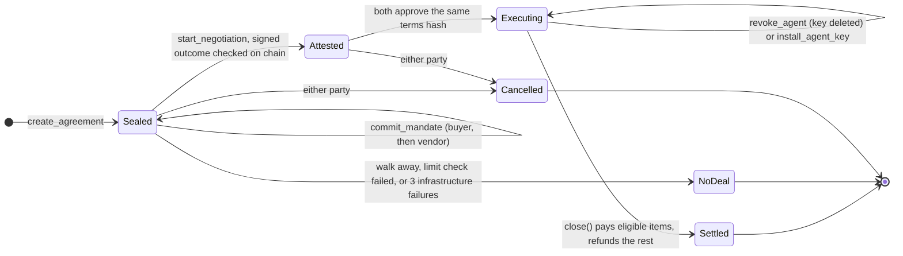
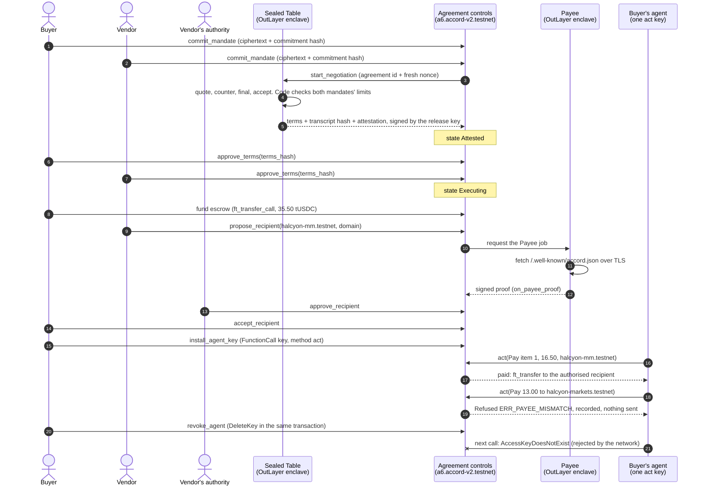
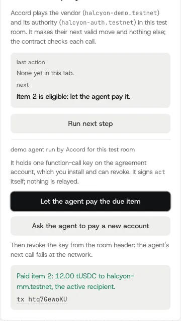
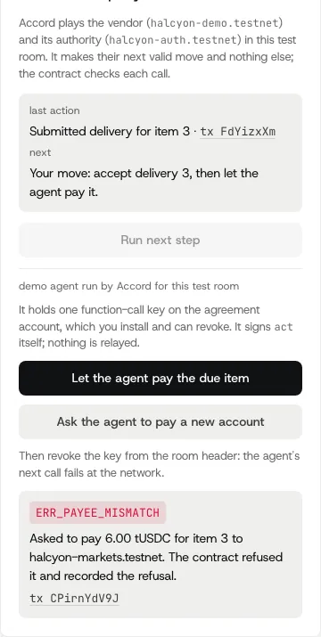

# How it works: lifecycle and one deal

The parts and the `act()` gates are in the README's [How it works](../README.md#how-it-works); the full design is [`platform/ARCHITECTURE.md`](../platform/ARCHITECTURE.md).

States are the contract's own (`State` in [`platform/crates/accord-core/src/types.rs`](../platform/crates/accord-core/src/types.rs)).

## The demo agent in a room

The literal path is [`platform/app/e2e/try-without-wallet.mjs`](../platform/app/e2e/try-without-wallet.mjs) (Playwright; it never clicks a pay button). The server side is [`platform/app/src/server/demo.ts`](../platform/app/src/server/demo.ts) and [`demoagent.ts`](../platform/app/src/server/demoagent.ts): the counterparty makes the vendor's next valid move, so calling it twice does nothing twice; the demo agent's key is derived per room and signs `act` itself, never through the relayer.

  
  &nbsp;&nbsp;
  
   The demo agent's panel: a payment inside the terms, then a redirect the contract refused.

